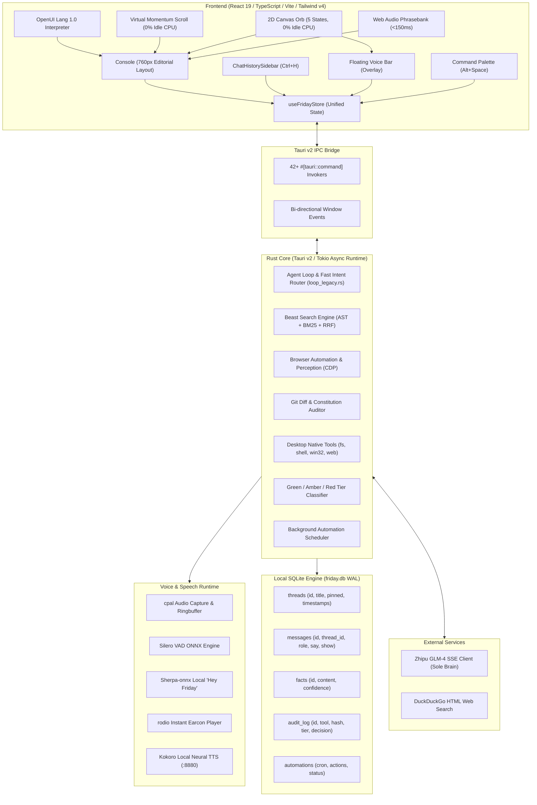

# FRIDAY — Complete System Blueprint, Architecture & Codebase Reference
> **Authoritative Specification for Autonomous Coding Agents & AI Systems**  
> *Target OS*: Windows 10 / 11 (64-bit) | *Version*: 1.0.0 Production Release  
> *Stack*: Tauri v2, Rust (2021 Edition), React 19, TypeScript 5.7, Tailwind CSS v4, Motion 12, SQLite (`rusqlite`), ONNX Runtime.

This document contains the complete technical breakdown of **FRIDAY**, covering every architectural layer, IPC bridge contract, database table, background tool, frontend component, and system resource.

---

## 1. Executive Summary & Identity

### 1.1 The Persona
FRIDAY (*Female Replacement Intelligent Digital Assistant Youth*) is an intelligent, voice-first desktop operator for Windows inspired by Kerry Condon's MCU portrayal. She is articulate, composed, witty, and razor-sharp.

### 1.2 Two-Channel Output Architecture
FRIDAY enforces the **Utterance Contract** on every single turn:
1. **`say` (Spoken Channel)**:
   - Natural conversational audio prose spoken via TTS or phrasebank.
   - Strictly 1 to 2 sentences.
   - **Banned**: URLs, markdown backticks, file paths, bullet points, asterisks.
2. **`show` (Visual Channel)**:
   - Rendered on screen in the primary Console.
   - GitHub-Flavored Markdown, tables, code blocks, diff previews, or generative **OpenUI Lang 1.0** interactive widgets.

### 1.3 Confirmation Tiers
- **`Green`**: Silent background execution (e.g., read file, search code, list windows) with past-tense spoken narration.
- **`Amber`**: Preview card rendered on screen with 1-sentence spoken confirmation; proceeds on "go ahead" or 8s timeout (e.g., file writes, opening apps).
- **`Red`**: Full interactive diff/details preview on screen; requires explicit typed or spoken "confirm" (e.g., file deletions, shell commands, git commits).

### 1.4 Strict Latency Budgets
- Earcon acoustic cue acknowledgement: **≤ 150 ms**
- Endpoint decision after speech: **≤ 280 ms**
- Intent routing: **≤ 15 ms**
- Perceived end-to-end voice turn: **≤ 1.8 s (p95)**
- Barge-in voice cutoff: **≤ 200 ms**

### 1.5 The Three Design Laws (`AGENTS.md`)
1. **Surface Law**: Rounded rectangles on an 8px grid (`16px` container radius, `8px` controls). Mica (Win11) / Acrylic (Win10) dark plates.
2. **One-Signal Law**: Single accent color `--color-acid: oklch(78% 0.19 152)` / `hsl(var(--signal))` appears at most twice per viewport, reserved strictly for active states (`running`, `verifying`, `listening`).
3. **Sub-Frame Law**: Transitions 120–220ms, transform & opacity only, `cubic-bezier(0.22, 1, 0.36, 1)`. 0% idle CPU for canvas orb and scroll loops. Zero `any` in TypeScript, zero `.unwrap()` in Rust.

---

## 2. Full Architecture Diagram



---

## 3. Directory & File Reference

```
c:\Users\anesx\Desktop\friday\
├── Cargo.lock
├── package.json                    # Scripts: dev, build, check, test, tauri
├── tsconfig.json                   # Strict TypeScript compiler configuration
├── vite.config.ts                  # Vite 6 + React 19 + Tailwind v4
├── AGENTS.md                       # Non-negotiable Constitution for FRIDAY
├── SYSTEM_ARCHITECTURE_REPORT.md   # System Architecture Report
├── FRIDAY_COMPLETE_ARCHITECTURE.md # [This Master Reference File]
│
├── src/                            # Frontend (React 19 + TypeScript 5.7)
│   ├── main.tsx                    # React DOM entry point
│   ├── App.tsx                     # Top-level window router (Console, Bar, Palette, Onboarding)
│   ├── lib/                        # State, IPC, AI client, Voice, Virtual Scrolling
│   │   ├── ai.ts                   # Two-channel LLM turn executor & OpenUI generator
│   │   ├── bindings.ts             # Rust-to-TypeScript IPC interface declarations
│   │   ├── ipc.ts                  # Tauri command invoke bridge & browser fallbacks
│   │   ├── kokoro.ts               # Kokoro local TTS client (FastAPI / OpenAI audio endpoint)
│   │   ├── lenis.ts                # Custom 0% CPU idle virtual momentum scroll engine
│   │   ├── phrasebank.ts           # Sub-150ms instant non-verbal acoustic earcon player
│   │   ├── seed.ts                 # Offline seed state fixtures & demo datasets
│   │   ├── store.ts                # Unified Zustand store (reactive state & persistence)
│   │   ├── types.ts                # TypeScript domain models (Message, Thread, Fact, ToolCall)
│   │   ├── utils.ts                # Class merging utility (clsx + tailwind-merge)
│   │   ├── voice.ts                # Voice capture, native audio IPC, RMS audio stream
│   │   └── workflow.ts             # Multi-step automation execution engine
│   ├── components/                 # Reusable UI primitives & graphics engines
│   │   ├── intelligent-ui/         # Generative OpenUI Lang 1.0 interpreter & components
│   │   │   ├── IntelligentUIRenderer.tsx # Dynamic AST parser, state binder, and renderer
│   │   │   ├── parser.ts           # Tokenizer & recursive AST builder (supports [] & {})
│   │   │   ├── types.ts            # AST node interfaces (Node, Primitive, MapMarker)
│   │   │   ├── examples.ts         # Pre-baked OpenUI statement templates
│   │   │   └── primitives/         # Layout, Typography, Controls, DataVisuals, Media, Interactive
│   │   ├── motion/                 # Bencho & Argon tactile physics
│   │   │   └── MouseInteractions.tsx # PerspectiveTilt (3D), SpotlightSurface (Aura), SpringChip, Magnetic
│   │   ├── providers/              # Component wrappers
│   │   │   └── SmoothScroll.tsx    # Lenis virtual momentum scroll container with spring indicator
│   │   ├── orb/                    # 2D Canvas reactive Orb (0% idle CPU)
│   │   │   └── FridayOrb.tsx       # Idle, Listening, Thinking, Speaking, Reasoning canvas states
│   │   ├── telemetry/              # Telemetry & performance visualizers
│   │   │   └── AudioSpectrumVisualizer.tsx # 30fps capped audio RMS visualizer
│   │   ├── layout/                 # Layout backgrounds
│   │   │   └── AtmosphericField.tsx# Ambient halftone dot grid
│   │   ├── chat/                   # Chat UI Components
│   │   │   └── ChatHistorySidebar.tsx # Collapsible session history drawer (Today, 7 Days, Older)
│   │   └── ui/                     # Primitives (button, textarea, tooltip, empty)
│   └── surfaces/                   # Major surface viewports
│       ├── console/                # Primary desktop operating console
│       │   ├── Console.tsx         # Main frame with titlebar, Mica drag region, Rail, and active tab
│       │   ├── Rail.tsx            # Canonical 64px black instrument navigation rail
│       │   ├── ChatTab.tsx         # Operating surface chat stream, OpenUI renderer, composer
│       │   ├── ToolCallCard.tsx    # Lifecycle execution card for native tools (4-step tracker)
│       │   ├── BeastTab.tsx        # Two-stage code search, AST chunking, symbol inspector
│       │   ├── ProjectsTab.tsx     # Desktop workspace manager, file editor, archetype scaffolder
│       │   ├── BrowserTab.tsx      # Browser perception snapshot tree, click/type/scroll actions
│       │   ├── ReviewTab.tsx       # Git diff auditor, unwrap linter, security audit
│       │   ├── AutomationsTab.tsx  # Cron job scheduler, trigger runner, history
│       │   ├── MemoryTab.tsx       # Associative memory facts, confidence badges, editor
│       │   ├── SkillsTab.tsx       # Active skills toggle & trigger patterns
│       │   ├── DelphiTab.tsx       # Toolcraft / Delphi tools workbench & JSON schemas
│       │   ├── AuditTab.tsx        # Cryptographic hash audit trail of all executed commands
│       │   ├── SettingsTab.tsx     # Provider endpoints, API keys, models, wake word tuning
│       │   ├── BenchoWatermelonPrimitives.tsx # Watermelon UI cards, toggles, drawers, sliders
│       │   └── Inspector.tsx       # Context & memory inspector drawer
│       ├── bar/                    # Floating compact voice bar viewport
│       │   └── Orb.tsx             # Floating desktop pill with live transcript
│       ├── palette/                # Command Palette (`Alt+Space` / `Ctrl+K`)
│       │   ├── Palette.tsx         # Fuzzy search popup command palette
│       │   └── commands.ts         # Static & dynamically derived commands (threads, skills, tools)
│       ├── onboarding/             # First-launch onboarding modal & permissions wizard
│       └── landing/                # Standalone landing showcase
│
└── src-tauri/                      # Backend (Rust + Tauri v2)
    ├── Cargo.toml                  # Rust dependencies, compilation profile (thin LTO, opt-level 3)
    ├── tauri.conf.json             # Tauri window definitions, permissions, security capabilities
    ├── build.rs                    # Tauri build hook
    └── src/
        ├── main.rs                 # Tauri entry point
        ├── lib.rs                  # Core backend runner: window vibrancy, 42+ IPC commands
        ├── agent/                  # Reasoning & Autonomous Operators
        │   ├── loop_legacy.rs      # Agent turn execution, fast intent router, OpenUI synthesis
        │   ├── beast.rs            # Beast Engine code search, tree-sitter AST parser, RRF ranking
        │   ├── browser.rs          # Chrome DevTools Protocol automation & DOM snapshots
        │   ├── review.rs           # Git diff reviewer, unwrap scanner, AST auditor
        │   ├── machine.rs          # Agent execution state machine
        │   └── mcp_client.rs       # Model Context Protocol (MCP) client bridge
        ├── tools/                  # Native Desktop OS Tools
        │   ├── mod.rs              # Filesystem, shell, window manipulation, system diagnostics, web search
        │   ├── delphi.rs           # Delphi schema reflection
        │   ├── scaffold.rs         # Project archetype scaffolding (Rust, React, Python)
        │   └── security.rs         # Safety classification (Green/Amber/Red)
        ├── voice/                  # Audio Pipeline & Local Models
        │   ├── capture.rs          # cpal microphone stream & ringbuffer capture
        │   ├── phrasebank.rs       # Sub-150ms instant non-verbal acoustic earcons via rodio
        │   ├── wakeword.rs         # Local wake word detector ("Hey Friday")
        │   ├── hotwords.rs         # Phonetic boosting & phrase corrections
        │   ├── normalize.rs        # Text-to-speech phonetic normalizer
        │   ├── silero_vad.rs       # Silero voice activity detection
        │   └── playback.rs         # Audio playback stream
        ├── providers/              # LLM Inference Providers
        │   ├── glm.rs              # Zhipu GLM / DeepSeek / OpenAI SSE streaming client
        │   ├── router.rs           # Query classifier (Light fast model vs Heavy reasoning model)
        │   └── models.rs           # Provider manager, latency telemetry, model catalog
        ├── memory/                 # Persistence & Semantic Memory
        │   ├── db.rs               # SQLite database (threads, messages, facts, audit, automations)
        │   └── facts.rs            # Fact extraction, confidence scoring, cosine similarity search
        └── scheduler/              # Scheduled Tasks
            └── mod.rs              # Background cron scheduler
```

---

## 4. Backend (Rust / Tauri v2) Functions & Modules

### 4.1 Module: `src-tauri/src/lib.rs` (Tauri IPC Core)
Main entry point for Tauri commands and desktop window management:
- `submit_utterance(utterance: String, mode: Option<String>)`: Executes turn through `loop_legacy.rs` with latency timing.
- `confirm_plan(plan_id: String)`: Approves deferred Amber/Red tier plan and triggers actions.
- `undo_last()`: Reverses the previous reversible workspace action.
- `start_mic_capture()` / `stop_mic_capture()`: Starts/stops the `cpal` background audio capture thread.
- `start_listening()` / `stop_listening()`: Controls the voice operating state machine.
- `get_audio_rms()`: Reads microphone input RMS and output audio RMS for 30fps visualizers.
- `barge_in()`: Instant audio playback kill switch (≤ 200ms).
- `is_speaking()`: Returns boolean status of audio output.
- `speak_text(text: String)`: Queues prose to local Kokoro TTS engine.
- `start_wake_word()` / `stop_wake_word()`: Manages local Sherpa-onnx "Hey Friday" wake word listener.
- `get_wake_word_status()` / `set_wake_word_sensitivity(sensitivity: f32)`: Controls wake word thresholds.
- `get_threads()`: Returns all threads ordered by `updated_at DESC`.
- `get_active_thread()` / `set_active_thread(thread_id: String)`: Gets/sets active thread ID in SQLite settings.
- `create_thread(thread_id: Option<String>, title: Option<String>)`: Creates new conversation thread with optional caller ID.
- `add_message(thread_id: String, role: String, say: Option<String>, show: Option<String>)`: Appends message to thread.
- `delete_thread(thread_id: String)`: Cascades deletion of thread and all its messages.
- `rename_thread(thread_id: String, title: String)`: Renames session title.
- `toggle_thread_pin(thread_id: String)`: Toggles pinned state of a thread.
- `get_messages(thread_id: String)`: Returns chronological messages for thread.
- `get_facts()` / `add_fact(content: String, confidence: Option<f32>)` / `delete_fact(id: String)`: Semantic memory CRUD.
- `get_audit_log()`: Returns recent SHA-256 cryptographic tool execution records.
- `get_automations()` / `toggle_automation(id: String)` / `trigger_automation(id: String)`: Scheduled cron tasks.
- `get_skills()` / `toggle_skill(id: String)`: Toolcraft skill triggers.
- `get_glm_settings()` / `update_glm_settings(settings: GlmSettingsDto)`: Configures LLM endpoints.
- `search_code(query: String, path: Option<String>)`: Ripgrep workspace search.
- `find_symbols(query: String, max_results: Option<usize>)`: Tree-sitter AST symbol extractor.
- `rrf_search(query: String)`: Beast hybrid BM25 + embedding search.
- `read_file_content(path: String, max_lines: Option<usize>)`: Reads workspace text.
- `list_directory(path: String)`: Lists workspace directory contents.
- `browser_snapshot(url: String)` / `browser_action(action: BrowserAction)`: Chrome DevTools Protocol automation.
- `review_diff()` / `review_scan()`: Git diff constitutional check & AST scanner.
- `capture_screen(target: Option<String>)`: Zero-latency desktop screenshot via Windows.Graphics.Capture.
- `screen_ocr(image_base64: Option<String>)`: Local offline text extraction via Windows.Media.Ocr.
- `list_windows()` / `focus_window(query: String)` / `set_window_state(query: String, state: String)`: Windows Win32 window management.
- `scan_desktop_repos()`: Discovers git repos on Desktop and Documents.
- `scaffold_project_archetype(archetype: String, target_dir: String, name: String)`: Scaffolds React, Tauri, or Python projects.
- `inspect_project_tree()` / `read_project_file()` / `write_project_file()` / `create_project_file_or_dir()` / `delete_project_path()`: Workspace IDE file operations.
- `execute_project_command(command: String, cwd: Option<String>)`: Executes shell commands in workspace.
- `get_project_git_diff()` / `commit_project_changes()` / `init_project_git()`: Workspace git integration.
- `app_minimize()` / `app_toggle_maximize()` / `app_is_maximized()` / `app_start_dragging()` / `app_close()`: Window controls.

### 4.2 Module: `src-tauri/src/agent/loop_legacy.rs` (Agent Execution Loop)
- `execute_turn(utterance: &str, mode: &str)`: Main turn pipeline. Matches intent, executes tools, records latency, synthesizes two-channel output (`say` and `show`), and logs audit entry.
- `is_web_browse(prompt: &str) -> bool`: Regex/heuristic classifier identifying browsing, product search, or hardware specs queries.
- `is_hardware_spec(prompt: &str) -> bool`: Specifically detects queries for laptop/phone/hardware specs.
- `synthesize_web_research_turn(...)`: Performs web search via DuckDuckGo, extracts data, and synthesizes generative OpenUI Lang 1.0 components (`Col`, `Card`, `SearchImage`, `Grid` of `Metric`s, `Table`).
- `synthesize_operator_turn(...)`: Executes general desktop tools, sanitizes outputs (stripping binary `%PDF` or raw JSON crawler trees), and produces Kerry Condon conversational prose.

### 4.3 Module: `src-tauri/src/agent/beast.rs` (Beast Engine)
- `chunk_code(path: &Path) -> Vec<CodeChunk>`: Tree-sitter AST parser dividing source code into semantic chunks (functions, classes, structs).
- `bm25_search(query: &str) -> Vec<ScoredChunk>`: In-memory lexical BM25 indexer.
- `rrf_combine(lexical_ranks, semantic_ranks) -> Vec<RrfRankedResult>`: Reciprocal Rank Fusion ($RRF\_Score = \sum \frac{1}{60 + rank}$) merging lexical and vector semantic hits.

### 4.4 Module: `src-tauri/src/tools/mod.rs` (Native Desktop OS Tools)
- `fs_read(path)`: Safe filesystem read with line limits.
- `fs_write(path, content)`: Filesystem write (Amber tier).
- `fs_list(path)`: Directory recursive walk.
- `shell_exec(command, cwd)`: Executes command in PowerShell or cmd (Red tier).
- `win_list()`: Enumerates visible Windows top-level windows using Win32 `EnumWindows`.
- `win_focus(title_query)`: Focuses matched window using Win32 `SetForegroundWindow`.
- `web_search(query)`: Scrapes DuckDuckGo HTML endpoint in <1.2s without API keys.
- `web_extract(url)`: Fetches HTML text with desktop Chrome `User-Agent` header and 4s timeout (eliminates 403 blocks).
- `sys_info()`: Reads CPU usage, memory consumption, and disk space.

### 4.5 Module: `src-tauri/src/memory/db.rs` (SQLite Persistence)
- `Database::init(path)`: Initializes SQLite with WAL mode (`PRAGMA journal_mode = WAL; PRAGMA foreign_keys = ON;`).
- `get_threads()`: Returns threads with message count via `LEFT JOIN messages`.
- `create_thread(id, title)`: Atomically inserts session record.
- `rename_thread(id, title)`: Renames session title.
- `toggle_thread_pin(id)`: Toggles pinned boolean (`UPDATE threads SET pinned = CASE WHEN pinned = 1 THEN 0 ELSE 1 END`).
- `delete_thread(id)`: Transactionally cascades message and thread record deletion.
- `add_message(thread_id, role, say, show)`: Stores individual message turns.
- `get_messages(thread_id)`: Fetches thread messages chronologically.
- `add_fact(content, confidence)` / `delete_fact(id)`: Manages associative memory facts.
- `log_audit(...)`: Records cryptographic SHA-256 tool execution trail.

### 4.6 Module: `src-tauri/src/voice/` (Audio & Speech Pipeline)
- `capture.rs`: Uses `cpal` to stream microphone audio into a thread-safe ringbuffer.
- `silero_vad.rs`: Runs ONNX Silero VAD to detect end-of-speech in ≤ 280ms.
- `wakeword.rs`: Local Sherpa-onnx engine listening for "Hey Friday".
- `phrasebank.rs`: Plays pre-cached acoustic earcons in ≤ 150ms using `rodio`.
- `normalize.rs`: Converts abbreviations and symbols into phonetic strings for TTS.
- `playback.rs`: Handles stream playback with instant cancellation on barge-in.

---

## 5. Frontend (React 19 / TypeScript 5.7) Functions & Components

### 5.1 Unified Zustand Store: `src/lib/store.ts`
- `tab`: Active Console tab (`chat`, `projects`, `browser`, `automations`, `memory`, `review`, `skills`, `beast`, `delphi`, `audit`, `settings`).
- `orb`: Active Orb state (`idle`, `listening`, `thinking`, `speaking`, `waiting`, `reasoning`).
- `threads`: Array of conversation threads with message history and pinned status.
- `activeThreadId`: Active session ID.
- `chatHistoryOpen`: Toggle for `ChatHistorySidebar`.
- `createThread(initialTitle?)`: Generates new session, updates state, and calls `create_thread` IPC.
- `setActiveThread(id)`: Switches conversation and calls `set_active_thread` IPC.
- `deleteThread(id)`: Deletes session via `delete_thread` IPC and selects adjacent session.
- `renameThread(id, title)`: Renames session and calls `rename_thread` IPC.
- `togglePinThread(id)`: Toggles pin and calls `toggle_thread_pin` IPC.
- `formatAutoThreadTitle(prompt)`: Formats first prompt into clean capitalized title truncated at word boundary before 42 characters with `…`.
- `sendChatMessage(text, expanded)`: Orchestrates the user turn: plays earcon, pushes user message, executes AI turn, updates UI, and triggers Kokoro voice playback.

### 5.2 Generative OpenUI Engine: `src/components/intelligent-ui/`
- `parser.ts`:
  - Recursive descent parser supporting both bracket syntax `Col([hero])` and block syntax `Col() { hero = ... }`.
  - Multi-argument positional parameter support: `Col(Title(...), Row(...), Grid(...))`.
- `IntelligentUIRenderer.tsx`:
  - Evaluates AST nodes and binds reactive `$variables`.
  - Resolves `Card` arguments dynamically (string titles vs child components).
- Primitives (`primitives/`):
  - `Layout.tsx`: `Col`, `Row`, `Grid`, `Card`, `Carousel`, `Box`, `Divider`, `Spacer`.
  - `Typography.tsx`: `Title`, `Text`, `Badge`, `List`, `ListItem`.
  - `Controls.tsx`: `Slider`, `Button`, `SegmentedControl`, `Checkbox`, `Timer`.
  - `DataVisuals.tsx`: `MapView` (Leaflet map with pins), `Chart` (SVG charts), `Metric` (KPIs).
  - `Media.tsx`: `Image`, `SearchImage` (responsive Unsplash fallback CDN).
  - `Interactive.tsx`: `Flashcard` (3D flip), `Celebration` (confetti), `Table` (sortable tabular data).

### 5.3 Motion & Tactile Physics: `src/components/motion/MouseInteractions.tsx`
- `PerspectiveTilt`: 3D perspective (`1000px`) card tilt mapped to pointer coordinates using Framer Motion springs (`stiffness: 320, damping: 28`).
- `SpotlightSurface`: Cursor-following radial gradient glow with smooth spring dampening (`stiffness: 450, damping: 32`).
- `Magnetic`: Physical cursor attraction on buttons and chips (`pullFactor: 0.28`).
- `SpringChip`: Spring-scaled tactile chip with hover/tap animations.

### 5.4 0% CPU Idle Virtual Scroll: `src/components/providers/SmoothScroll.tsx`
- Virtual momentum scrolling via `src/lib/lenis.ts`.
- Automatically sleeps animation loop when velocity drops below `0.001` (0% CPU at idle).
- Instant fallback when `prefers-reduced-motion` is active.

### 5.5 2D Canvas Reactive Orb: `src/components/orb/FridayOrb.tsx`
- 40px reactive circle with 5 visual states (`idle`, `listening`, `thinking`, `speaking`, `reasoning`).
- Completely stops `requestAnimationFrame` when state is `idle` (0% CPU at idle).

### 5.6 Primary Console Tabs (`src/surfaces/console/`)
- `ChatTab.tsx`: Main chat stream with 760px column, `CollapsibleToolCalls` (compact pill grouping), composer, and interactive plan confirmation cards.
- `ToolCallCard.tsx`: 4-step progress tracker (`Queued`, `Running`, `Verifying`, `Complete`) with error sanitization (`sanitizeToolSummary`).
- `ChatHistorySidebar.tsx`: 260px drawer with search, chronological grouping (`Pinned`, `Today`, `Yesterday`, `Previous 7 Days`, `Older`), inline rename, and pin toggle.
- `ProjectsTab.tsx`: Workspace directory explorer, file viewer/editor, and project archetype scaffolder.
- `BeastTab.tsx`: Hybrid BM25/AST code search engine and symbol inspector.
- `BrowserTab.tsx`: Chrome DevTools Protocol DOM snapshot visualizer and page automation.
- `ReviewTab.tsx`: Git diff analyzer and constitutional unwrap linter.
- `AutomationsTab.tsx`: Cron job automation scheduler and history.
- `MemoryTab.tsx`: Semantic memory viewer and fact editor.
- `SkillsTab.tsx`: Toolcraft skills manager and trigger toggles.
- `DelphiTab.tsx`: Delphi toolcraft workbench.
- `AuditTab.tsx`: Cryptographic SHA-256 audit log of all desktop actions.
- `SettingsTab.tsx`: AI provider settings, Kokoro endpoint, and wake word tuner.

---

## 6. Complete Inventory of System Resources Used

1. **SQLite Database**:
   - Location: `%APPDATA%/com.friday.app/friday.db` (or local profile)
   - Configuration: WAL mode, foreign keys enabled, indices on `thread_id` and `created_at`.
2. **Local AI Services**:
   - **Kokoro TTS**: Local neural TTS server running on `http://localhost:8880` (FastAPI).
   - **Silero VAD**: ONNX model loaded via ONNX Runtime for voice activity detection.
   - **Sherpa-onnx**: Local wake word model for offline "Hey Friday" detection.
3. **External Cloud Services**:
   - **Zhipu GLM-4 API**: Sole cloud brain for reasoning, tool planning, and OpenUI synthesis.
   - **DuckDuckGo HTML**: Fast scraping endpoint for search results without API keys.
   - **Unsplash CDN**: Fallback photography for OpenUI carousels and cards.
4. **Native Windows Operating System APIs**:
   - **Windows.Graphics.Capture**: Hardware-accelerated desktop screenshot capture.
   - **Windows.Media.Ocr**: Built-in Windows OCR for screen text extraction.
   - **Win32 User32 APIs**: `EnumWindows`, `GetWindowTextW`, `SetForegroundWindow`, `ShowWindow`.
   - **WASAPI Audio**: `cpal` microphone stream capture and `rodio` audio playback.

---

## 7. Verification & Release Build Suite

- **Rust Backend Suite**: `cargo test --manifest-path src-tauri/Cargo.toml --lib` (**62/62 tests passed**).
- **Vitest Frontend Suite**: `vitest run` (**70/70 tests passed** across `chat-history`, `intelligent-ui`, and `core-journeys`).
- **TypeScript Strict Check**: `pnpm check` (`tsc --noEmit`) (**0 errors**).
- **Vite Production Bundler**: `pnpm build` (**0 bundle errors**).
- **Standalone Binary Build**: `pnpm tauri build --no-bundle` -> produces `src-tauri/target/release/friday.exe`.
