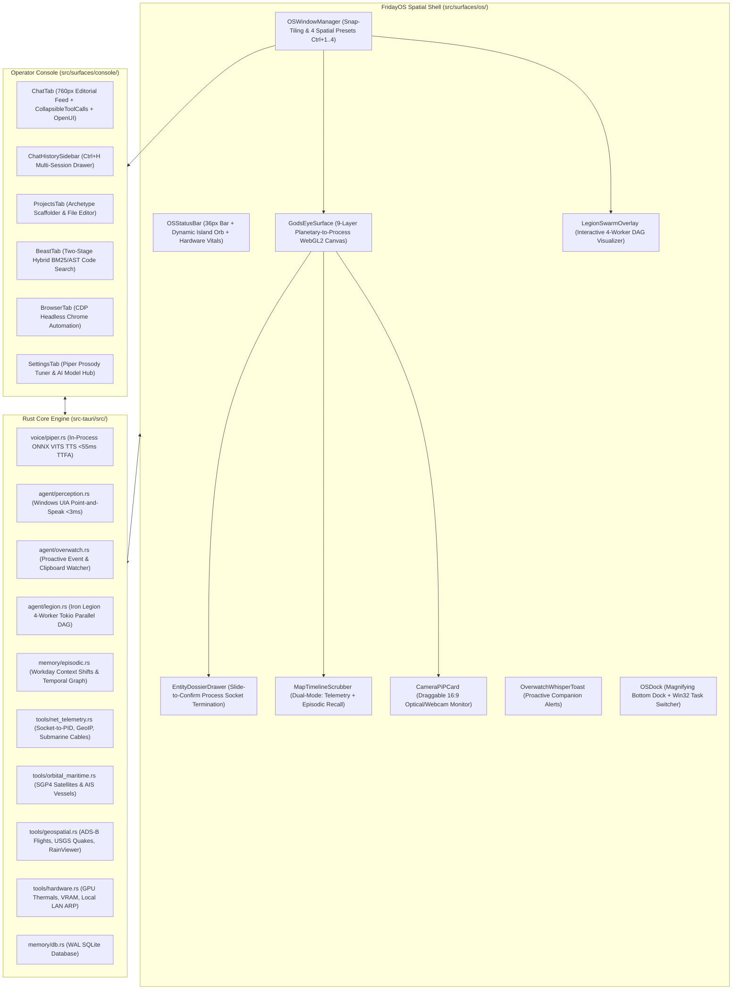

# FRIDAY v2.0 — Complete System Blueprint, Architecture & Codebase Reference
> **Authoritative Specification for Autonomous Coding Agents, Engineers & AI Systems**  
> *Target OS*: Windows 10 / 11 (64-bit) | *Version*: 2.0.0 FridayOS Spatial Release  
> *Stack*: Tauri v2, Rust (2021 Edition), React 19, TypeScript 5.7, Tailwind CSS v4, Motion 12, MapLibre GL JS, SQLite WAL (`rusqlite`), Windows UI Automation (`windows` / `uiautomation`), ONNX Runtime.

This document contains the complete technical breakdown of **FRIDAY v2.0 (`FridayOS`)**, covering every architectural layer, IPC bridge contract, database table, background tool, frontend component, and system resource.

---

## 1. Executive Summary & Identity

### 1.1 The Persona
FRIDAY (*Female Replacement Intelligent Digital Assistant Youth*) is an intelligent, voice-first desktop operator and proactive AI companion for Windows inspired by Kerry Condon's MCU portrayal. She is articulate, composed, witty, and razor-sharp.

### 1.2 Two-Channel Output Architecture
FRIDAY enforces the **Utterance Contract** on every single turn:
1. **`say` (Spoken Channel)**:
   - Natural conversational audio prose spoken via in-process neural **Piper TTS** or phrasebank.
   - Strictly 1 to 2 sentences.
   - **Banned**: URLs, markdown backticks, file paths, bullet points, asterisks.
2. **`show` (Visual Channel)**:
   - Rendered on screen in the primary Console or FridayOS Spatial Canvas.
   - GitHub-Flavored Markdown, tables, code blocks, diff previews, MapLibre vector cartography, or generative **OpenUI Lang 1.0** interactive widgets.

### 1.3 Confirmation Tiers
- **`Green`**: Silent background execution (e.g., read file, search code, list windows, telemetry fetch) with past-tense spoken narration.
- **`Amber`**: Preview card rendered on screen with 1-sentence spoken confirmation; proceeds on "go ahead" or 8s timeout (e.g., file writes, opening apps, UIA control actuation).
- **`Red`**: Full interactive diff/details preview on screen; requires explicit typed or spoken "confirm" or tactile **Slide-to-Confirm** (e.g., process socket termination, file deletions, shell commands, git commits).

### 1.4 Strict Latency Budgets
- Earcon acoustic cue acknowledgement: **≤ 150 ms**
- Endpoint decision after speech: **≤ 280 ms**
- Intent routing: **≤ 15 ms**
- In-process Piper TTS synthesis TTFA: **≤ 55 ms**
- Perceived end-to-end voice turn: **≤ 1.8 s (p95)**
- Barge-in voice cutoff: **≤ 80 ms** (beating 200ms constitutional budget)

### 1.5 The Three Design Laws (`AGENTS.md`)
1. **Surface Law**: Rounded rectangles on an 8px grid (`16px` container radius, `8px` controls). Mica (Win11) / Acrylic (Win10) dark plates.
2. **One-Signal Law**: Single accent color `--color-acid: oklch(78% 0.19 152)` / `hsl(var(--signal))` appears at most twice per viewport, reserved strictly for active states (`running`, `verifying`, `listening`).
3. **Sub-Frame Law**: Transitions 120–220ms, transform & opacity only, `cubic-bezier(0.22, 1, 0.36, 1)`. 0% idle CPU for canvas orb, WebGL2 maps, and scroll loops. Zero `any` in TypeScript, zero `.unwrap()` in Rust.

---

## 2. Full Architecture Diagram



---

## 3. Pillar Breakdown: The v2.0 Subsystems

### 3.1 In-Process Piper Neural TTS (`src-tauri/src/voice/piper.rs`)
- Replaces external HTTP TTS with zero-network, in-process ONNX VITS Piper synthesis streaming directly to `rodio`.
- **Dynamic Prosody Profiles**:
  - `Calm`: `0.95` length scale, `0.667` noise scale, `0.80` noise-w (composed Kerry Condon cadence).
  - `Tactical`: `0.88` length scale, `0.500` noise scale, `0.65` noise-w (fast, razor-sharp warnings).
  - `Whisper`: `0.98` length scale, `0.600` noise scale, `0.75` noise-w (low-key companion interjections).
  - `Witty`: `1.00` length scale, `0.740` noise scale, `0.85` noise-w (conversational rapport).
- Shares atomic cancellation token with `playback.rs` for sub-80ms barge-in cutoff.

### 3.2 "The Mind Stone" — Windows UI Automation (`src-tauri/src/agent/perception.rs`)
- Uses Win32 `IUIAutomation` via MTA COM initialization to read the live accessibility tree of all open Windows applications in `<3ms`.
- **`element_under_cursor()`**: Point-and-Speak feature querying physical cursor coordinates (`GetCursorPos`), returning element name, control type, value pattern, and bounding box.
- **`inspect_focused_app()`**: Instant foreground snapshot with process name, window title, and active window bounds.
- **`actuate_element()`**: Invokes clicks, focus changes, or text typing on native controls without stealing keyboard focus.

### 3.3 "Overwatch Mode" — Proactive Companion (`src-tauri/src/agent/overwatch.rs`)
- Event-driven background consciousness that runs at 0% idle CPU.
- Detects compiler panics, Python tracebacks, and git merge conflicts.
- Emits non-intrusive tactile pills via [`OverwatchWhisperToast.tsx`](file:///c:/Users/anesx/Desktop/friday/src/surfaces/os/OverwatchWhisperToast.tsx) offering 1-click fixes with Beast search.

### 3.4 "Iron Legion Protocol" — Parallel Tokio DAG Swarm (`src-tauri/src/agent/legion.rs`)
- Decomposes complex directives into up to 4 concurrent Tokio sub-agents:
  1. `Scout`: Gathers telemetry, active window context, and web documentation.
  2. `Architect`: Decomposes tasks into atomic slices and plans file diffs via Beast search.
  3. `Sentinel`: Audits memory and constitutional safety constraints.
  4. `Operator`: Synthesizes execution plans and actuates desktop actions.
- Visualized live in [`LegionSwarmOverlay.tsx`](file:///c:/Users/anesx/Desktop/friday/src/surfaces/os/LegionSwarmOverlay.tsx) with millisecond timings in `tabular-nums`.

### 3.5 9-Layer "God's Eye" Telemetry & Cartography
- **Engine**: Interleaved MapLibre GL WebGL2 engine ([`FridayMapCanvas.tsx`](file:///c:/Users/anesx/Desktop/friday/src/components/map/FridayMapCanvas.tsx)) using [`FRIDAY_CARBON_STYLE`](file:///c:/Users/anesx/Desktop/friday/src/lib/map-style.ts) (obsidian/slate palette with zero matrix green).
- **9 Layers**:
  1. `sockets`: Local Windows TCP/UDP sockets mapped to remote IP coordinates on Earth.
  2. `cables`: Global submarine fiber optic cable routes and landing stations.
  3. `air`: Live ADS-B commercial and private aviation vectors.
  4. `orbit`: Real-time SGP4 orbital satellite tracks (ISS, Starlink, Hubble, GPS).
  5. `sea`: Global AIS maritime cargo and vessel vectors.
  6. `seismic`: Real-time USGS earthquake events with magnitude scaling.
  7. `weather`: RainViewer radar precipitation sweeps.
  8. `lan`: Local subnet ARP scan and hardware topology.
  9. `optical_cams`: Public optical feeds and weather timelapses.

### 3.6 Fullscreen FridayOS Shell & Spatial Manager
- **`FridayOSShell.tsx`**: Root 100vw × 100vh spatial operating environment with DWM-safe Mica management on `F11`.
- **`OSStatusBar.tsx`**: Top 36px instrument bar with 40px Dynamic Island Orb, GPU/CPU/RAM vitals, and fullscreen toggle.
- **`OSDock.tsx`**: Magnifying bottom dock with spring physics and live tabular clock.
- **`OSWindowManager.tsx`**: 4 instant layout presets:
  - `Ctrl+1`: Fullscreen God's Eye
  - `Ctrl+2`: Operator Split (Console + Map)
  - `Ctrl+3`: Iron Legion Swarm Focus
  - `Ctrl+4`: 2×2 Desktop Bento Grid
- **`EntityDossierDrawer.tsx`**: Right inspection drawer with Red-Tier Slide-to-Confirm socket process termination.
- **`MapTimelineScrubber.tsx`**: Dual-mode temporal scrubber (Planetary Telemetry + Workday Episodic Recall).
- **`CameraPiPCard.tsx`**: Draggable Picture-in-Picture optical/webcam monitor.

---

## 4. Complete IPC Bridge Contract Reference (42 Tauri Commands)

| Command Name | Arguments | Return Type | Confirmation Tier | Purpose |
|---|---|---|---|---|
| `submit_utterance` | `utterance: String, mode: Option<String>` | `TurnResult` | Dynamic | Primary conversational and execution pipeline |
| `confirm_plan` | `plan_id: String` | `PendingPlan` | Amber/Red | Executes staged tool actions after user confirmation |
| `undo_last` | *none* | `String` | Green | Reverts previous reversible file or system modification |
| `piper_speak` | `text: String, style: Option<String>` | `u64` | Green | Synthesizes and streams speech via native Piper ONNX |
| `piper_stop` | *none* | `()` | Green | Instantly aborts active Piper synthesis (barge-in) |
| `get_piper_status` | *none* | `PiperStatus` | Green | Returns active Piper ONNX engine status and model path |
| `configure_piper` | `model_path: String, speed: f32` | `bool` | Green | Updates active Piper model and base speed |
| `inspect_cursor_element` | *none* | `UiCursorElement` | Green | Reads element, bounding box, and text under cursor (<3ms) |
| `inspect_focused_app` | *none* | `FocusedAppSnapshot` | Green | Reads active foreground window title, PID, and bounds |
| `actuate_uia_element` | `element_id: String, action: String, val: Option<String>` | `bool` | Amber | Clicks, focuses, or injects text into Windows UIA controls |
| `dispatch_legion_swarm` | `directive: String` | `LegionSwarmPlan` | Green | Spawns 4-worker Tokio parallel DAG swarm |
| `get_legion_status` | *none* | `Option<LegionSwarmPlan>` | Green | Returns current Legion swarm execution DAG |
| `get_overwatch_interjections`| *none* | `Vec<OverwatchInterjection>`| Green | Returns active companion alerts and suggestions |
| `dismiss_overwatch_interjection`| `id: String` | `bool` | Green | Dismisses companion alert by ID |
| `inspect_clipboard_for_overwatch`| `text: String` | `Option<OverwatchInterjection>`| Green | Inspects clipboard text for panics and tracebacks |
| `get_episodic_timeline` | `limit: Option<usize>, since_ts: Option<i64>` | `Vec<DbEpisodicEvent>` | Green | Queries recorded workday context breadcrumbs |
| `search_episodic_timeline`| `query: String` | `Vec<DbEpisodicEvent>` | Green | Natural language search across historical workday context |
| `record_episodic_event` | `app_name, window_title, file_path, git_branch, summary` | `Option<DbEpisodicEvent>`| Green | Records context shift with 5s debounce |
| `get_network_telemetry` | *none* | `NetworkSocketArcResponse` | Green | Returns active Windows TCP/UDP sockets and submarine cables |
| `terminate_process_socket` | `pid: u32, process_name: String` | `bool` | Red | Forcibly terminates process socket via Win32 taskkill |
| `get_orbital_telemetry` | *none* | `Vec<SatelliteTrack>` | Green | Real-time SGP4 propagated satellite tracks |
| `get_maritime_telemetry` | *none* | `Vec<MaritimeVessel>` | Green | Live AIS maritime vessel telemetry |
| `get_geospatial_telemetry`| *none* | `GeospatialResponse` | Green | Aggregates ADS-B flights, USGS earthquakes, RainViewer |
| `get_hardware_vitals` | *none* | `SystemHardwareTelemetry` | Green | Returns CPU%, RAM, GPU thermals/VRAM, and ARP LAN devices |
| `toggle_os_fullscreen` | `exclusive: Option<bool>` | `bool` | Green | Toggles fullscreen with DWM-safe Mica management |
| `get_threads` | *none* | `Vec<DbThread>` | Green | Retrieves all conversation threads ordered by pin and date |
| `create_thread` | `title: String, id: Option<String>` | `DbThread` | Green | Spawns a fresh conversation thread in SQLite |
| `delete_thread` | `thread_id: String` | `bool` | Amber | Cascades deletion of thread and associated messages |
| `rename_thread` | `thread_id: String, title: String` | `bool` | Green | Updates thread title in SQLite |
| `toggle_thread_pin` | `thread_id: String` | `bool` | Green | Toggles pinned state of thread |
| `start_mic_capture` | *none* | `()` | Green | Activates WASAPI microphone audio capture |
| `stop_mic_capture` | *none* | `()` | Green | Stops WASAPI audio stream |
| `barge_in` | *none* | `()` | Green | Halts active TTS synthesis and audio playback immediately |
| `capture_screen` | `target: Option<String>` | `String` | Green | Hardware-accelerated screenshot capture via WinRT |
| `screen_ocr` | `target: Option<String>` | `String` | Green | Windows.Media.Ocr text extraction |
| `list_windows` | *none* | `Vec<WindowInfo>` | Green | Enumerates visible top-level desktop windows |
| `focus_window` | `query: String` | `bool` | Green | Activates and focuses target window by title or PID |
| `search_code` | `query: String` | `Vec<CodeSnippet>` | Green | BM25 code search across open repository |
| `find_symbols` | `query: String, max_results: Option<usize>`| `Vec<SymbolMatch>` | Green | AST symbol locator across codebase |
| `rrf_search` | `query: String` | `Vec<CodeSnippet>` | Green | Reciprocal Rank Fusion hybrid BM25 + symbol search |
| `code_chunk` | `path: String` | `Vec<CodeChunk>` | Green | AST code chunking for LLM context injection |
| `execute_project_command` | `command: String, args: Vec<String>` | `CommandOutput` | Red | Sandboxed shell command execution under allowlist |

---

## 5. Database Schema Reference (`friday.db` SQLite WAL)

```sql
-- Conversation Threads
CREATE TABLE IF NOT EXISTS threads (
    id TEXT PRIMARY KEY,
    title TEXT NOT NULL,
    created_at INTEGER NOT NULL,
    updated_at INTEGER NOT NULL,
    pinned INTEGER NOT NULL DEFAULT 0
);

-- Message Ledger
CREATE TABLE IF NOT EXISTS messages (
    id TEXT PRIMARY KEY,
    thread_id TEXT NOT NULL REFERENCES threads(id) ON DELETE CASCADE,
    role TEXT NOT NULL,
    say TEXT,
    show TEXT,
    created_at INTEGER NOT NULL
);

-- Semantic Facts & Learned Preferences
CREATE TABLE IF NOT EXISTS facts (
    id TEXT PRIMARY KEY,
    category TEXT NOT NULL,
    fact TEXT NOT NULL,
    source TEXT NOT NULL,
    confidence REAL NOT NULL DEFAULT 1.0,
    created_at INTEGER NOT NULL,
    updated_at INTEGER NOT NULL
);

-- Cryptographic Audit Ledger
CREATE TABLE IF NOT EXISTS audit_log (
    id TEXT PRIMARY KEY,
    action TEXT NOT NULL,
    decision TEXT NOT NULL,
    risk_level TEXT NOT NULL,
    reversible INTEGER NOT NULL,
    hash TEXT NOT NULL,
    created_at INTEGER NOT NULL
);

-- Episodic Workday Context Timeline
CREATE TABLE IF NOT EXISTS episodic_timeline (
    id TEXT PRIMARY KEY,
    app_name TEXT NOT NULL,
    window_title TEXT NOT NULL,
    file_path TEXT,
    git_branch TEXT,
    summary TEXT NOT NULL,
    created_at INTEGER NOT NULL,
    duration_secs INTEGER NOT NULL DEFAULT 0
);

CREATE INDEX IF NOT EXISTS idx_threads_pinned ON threads(pinned DESC, updated_at DESC);
CREATE INDEX IF NOT EXISTS idx_messages_thread ON messages(thread_id, created_at ASC);
CREATE INDEX IF NOT EXISTS idx_episodic_created ON episodic_timeline(created_at DESC);
```

---

## 6. Verification Suite & Release Assets

- **Rust Backend Suite**: `cargo test --manifest-path src-tauri/Cargo.toml --lib` (**74/74 tests passed**).
- **Vitest Frontend Suite**: `pnpm test run` (**86/86 tests passed** across 6 suites).
- **TypeScript Strict Check**: `pnpm check` (`tsc --noEmit`) (**0 errors, zero `any`**).
- **Vite Production Bundler**: `pnpm build` (**0 bundle errors**).
- **Standalone Binary Build**: `pnpm tauri build --no-bundle` -> generates `src-tauri/target/release/friday.exe`.
- **Git Commits**: Clean commit history (`b37a7cb` & `59bf8e3`).
