<div align="center">

# FRIDAY.

A Windows desktop assistant with local speech, project workspaces, research tools, and an Android companion.

**Windows 10 / 11** · **Tauri 2 + React 19 + Rust** · **Local speech** · **Development preview**

[Downloads](#downloads) · [Screenshots](#a-look-inside) · [Build from source](#get-started) · [Architecture](#how-it-fits-together) · [2026 roadmap](#2026-rollout-roadmap)

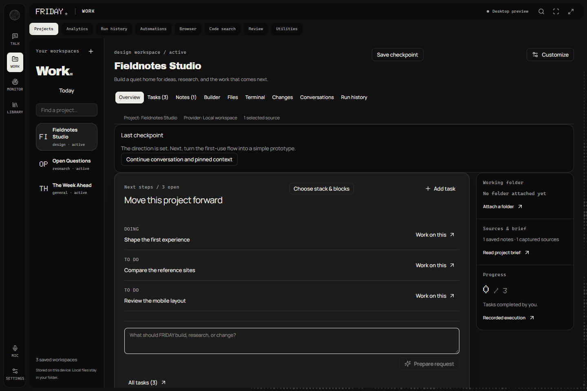

</div>

Type or dictate a request, review the plan, and follow its progress. Each project keeps its own tasks, notes, sources, and model provider. Attach a folder for file and terminal tools, or use a workspace without one.

The interface follows [Atmospheric Halftone OS](DESIGN.md): dark surfaces, halftone edges, and violet for active work and focus.

## Downloads

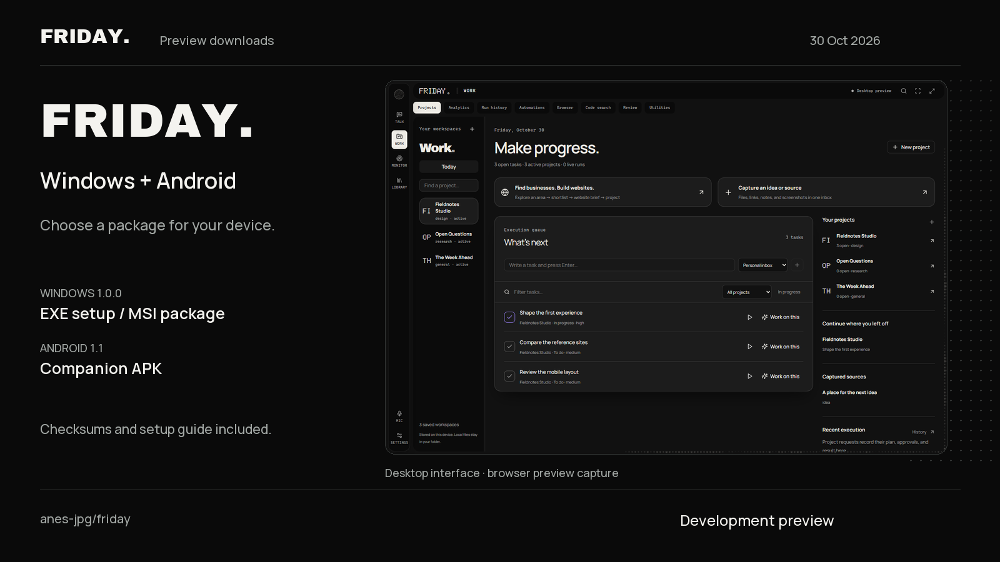

| Windows setup | Windows Installer | Android companion |
| --- | --- | --- |
| [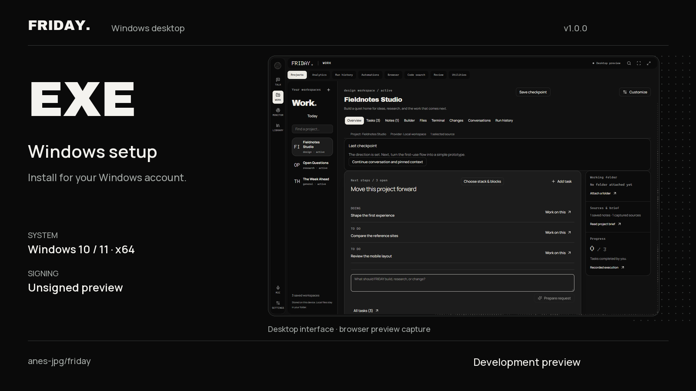](https://github.com/anes-jpg/friday/releases/download/v1.0.0-preview.20261030/FRIDAY-1.0.0-windows-x64-setup.exe) | [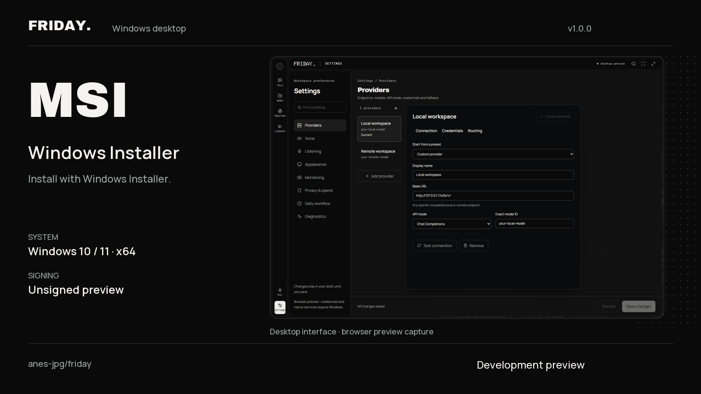](https://github.com/anes-jpg/friday/releases/download/v1.0.0-preview.20261030/FRIDAY-1.0.0-windows-x64.msi) | [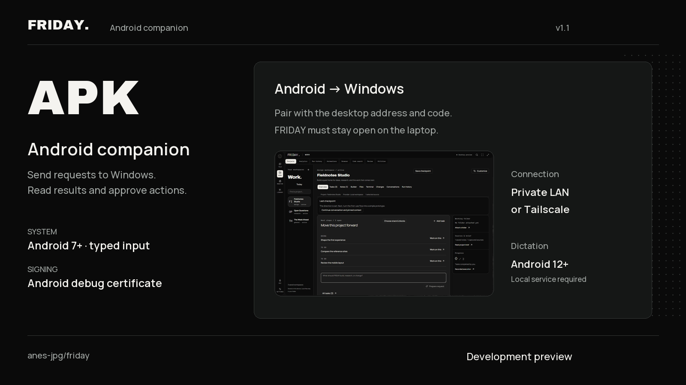](https://github.com/anes-jpg/friday/releases/download/v1.0.0-preview.20261030/FRIDAY-Companion-1.1-android-debug.apk) |
| **[Download EXE](https://github.com/anes-jpg/friday/releases/download/v1.0.0-preview.20261030/FRIDAY-1.0.0-windows-x64-setup.exe)** · v1.0.0 | **[Download MSI](https://github.com/anes-jpg/friday/releases/download/v1.0.0-preview.20261030/FRIDAY-1.0.0-windows-x64.msi)** · v1.0.0 | **[Download APK](https://github.com/anes-jpg/friday/releases/download/v1.0.0-preview.20261030/FRIDAY-Companion-1.1-android-debug.apk)** · v1.1 |
| Windows 10 / 11, x64. Installs for your account. | Windows 10 / 11, x64. Uses Windows Installer. | Android 7+ for typed requests. Android 12+ and a local recognition service for dictation. |

These are **development previews**: Windows packages are unsigned, and Android uses a debug certificate. Choose one Windows installer. The phone app needs FRIDAY running on Windows and a separately provisioned companion Python runtime. Clean-machine installation and phone hardware checks are still pending.

[Release and setup guide](https://github.com/anes-jpg/friday/releases/tag/v1.0.0-preview.20261030) · [SHA-256 checksums](https://github.com/anes-jpg/friday/releases/download/v1.0.0-preview.20261030/SHA256SUMS.txt) · [Installation instructions](docs/releases/INSTALL.md)

[Download the matching development source](https://github.com/anes-jpg/friday/releases/download/v1.0.0-preview.20261030/FRIDAY-preview-2026-10-30-source.zip). It includes companion and research changes not yet committed to master, file hashes, and the local Rust speech wrappers. Model weights and Python environments are separate prerequisites.

## A look inside

Screenshots show the browser preview with example projects and provider profiles. Native Windows tools and speech require the desktop app.

### Onboarding

Start from a software, research, or everyday goal. The guide is optional and saves progress when you leave for Settings or a workspace.

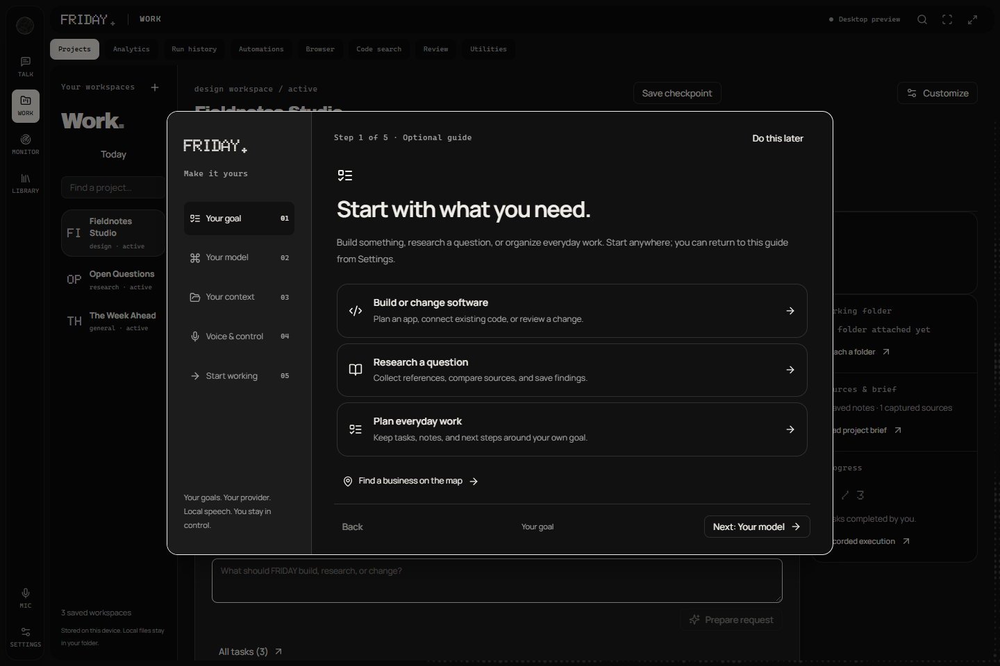

<table>
<tr>
<td width="50%"><strong>Project setup</strong><br />Custom goals, optional folders and presets, a saved provider, and a response language.</td>
<td width="50%"><strong>Project tasks</strong><br />Searchable tasks, priorities, status, and actions for the selected project.</td>
</tr>
<tr>
<td>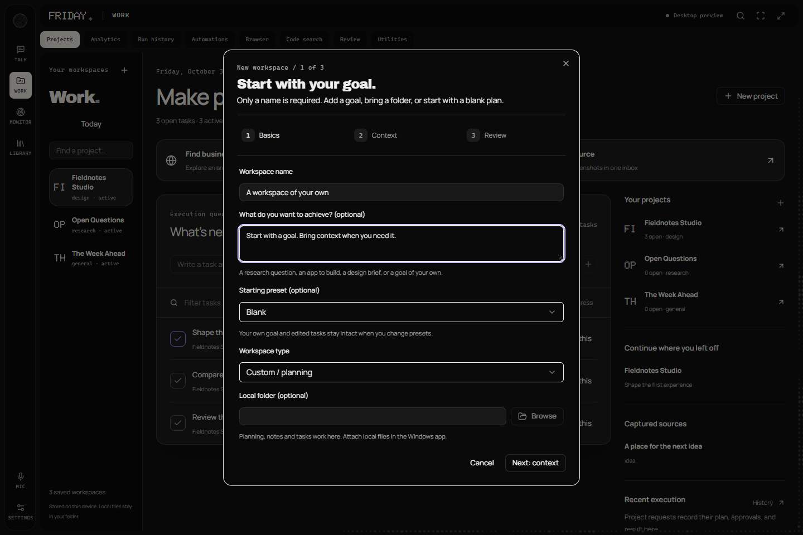</td>
<td>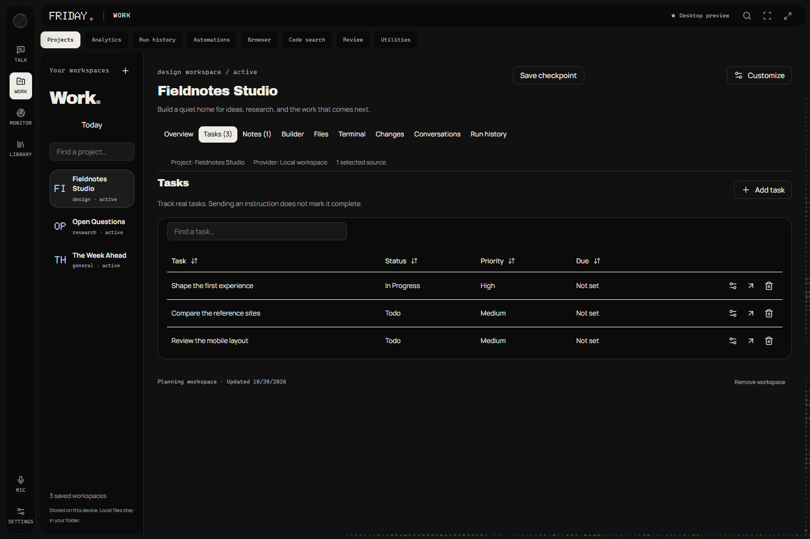</td>
</tr>
<tr>
<td><strong>Today</strong><br />Tasks, captures, and saved checkpoints.</td>
<td><strong>Model providers</strong><br />Local or remote OpenAI-compatible endpoints, exact model names, API mode, and credentials.</td>
</tr>
<tr>
<td>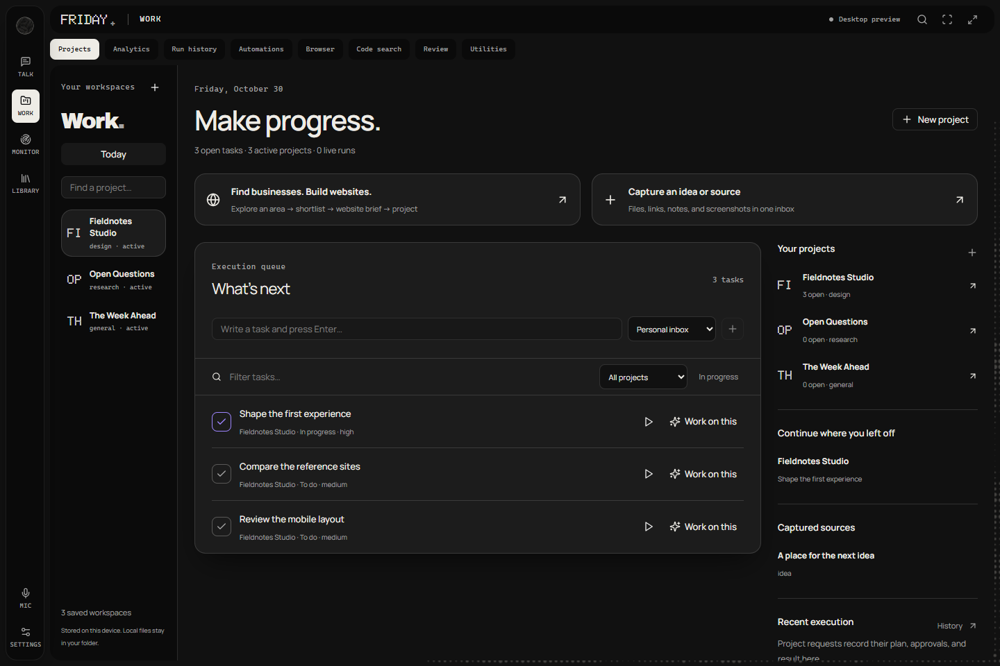</td>
<td>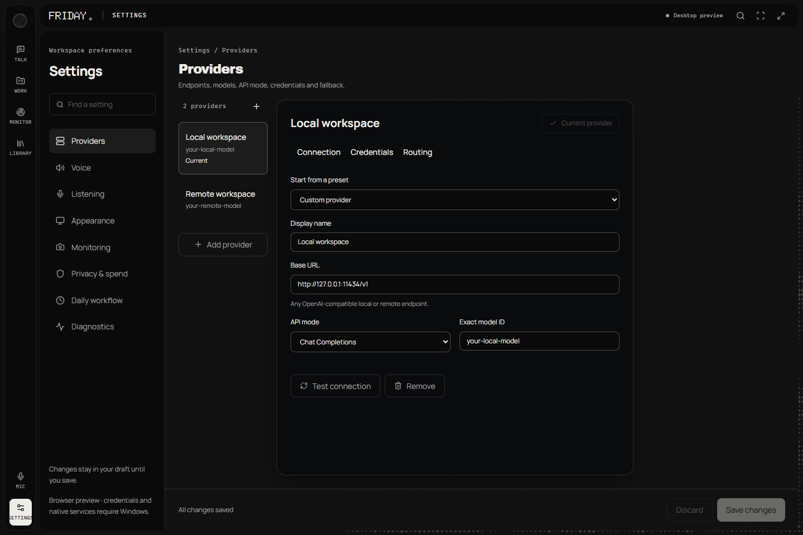</td>
</tr>
</table>

## What you can do today

| Area | Available in the codebase |
| --- | --- |
| Conversations | Typed requests, streaming answers, conversation history, source context, and structured answer views. |
| Voice | Local recognition and speech components, push-to-talk controls, readiness reporting, and interruption. Requires a provisioned speech runtime and models. |
| Projects | Custom goals, optional folders and presets, per-project providers, response languages, references, tasks, notes, and checkpoints. |
| Daily work | Quick capture, a task queue, saved sources, routines, reminders, and resuming work with its context. |
| Developer tools | Native project file browsing and editing, terminal commands, Git views, and website previews. |
| Maps and research | Map browsing, place details, selected-business research, source links, and a business-to-website workflow. External sources can be unavailable. |
| Control and recovery | Plans, tiered confirmation, execution history, and undo receipts for supported reversible actions. |
| Android companion | Preview client for reviewed requests, desktop progress, approval previews, results, and receipt-specific undo. Requires pairing and the companion runtime. |

The spatial control room, multi-agent visualizer, some telemetry layers, and parts of browser automation contain demonstration or placeholder behavior. Wake-word activation is unavailable. The companion has automated protocol checks; physical phone use, remote networking, and native voice still need end-to-end testing.

## How it fits together

The React interface presents work and context. Tauri connects it to the Rust runtime, which owns execution, approval, recovery, and local records. Local speech helpers provide recognition and playback. The model endpoint comes from the selected provider profile; optional Python tools extend the desktop runtime.

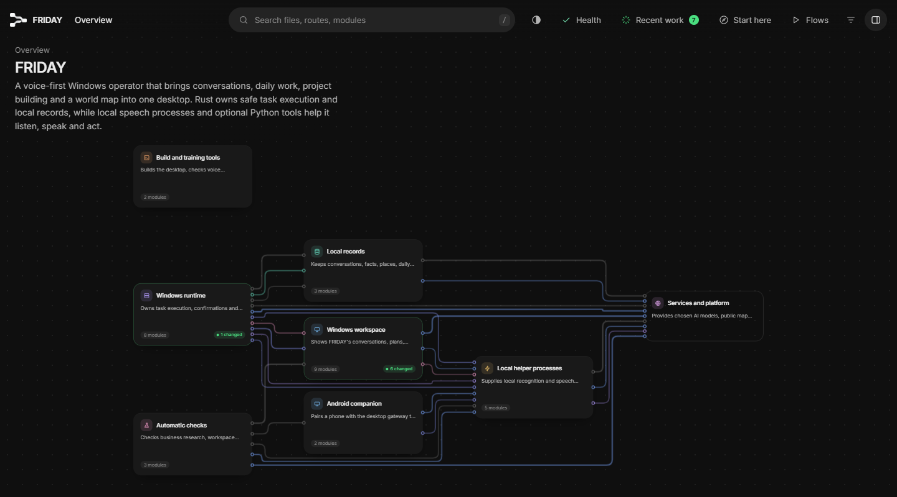

<details>
<summary><strong>Open the desktop subsystem view</strong></summary>

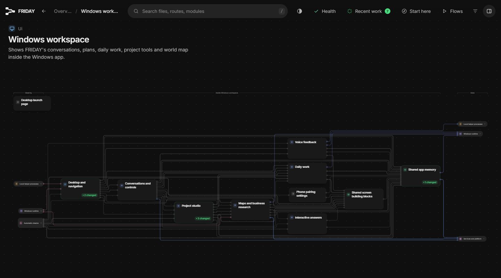

</details>

[Download the interactive Floorplan](https://raw.githubusercontent.com/anes-jpg/friday/master/docs/architecture/index.html) and open the saved HTML in a browser. It includes file descriptions, connections, and guided flows in one offline file. GitHub displays HTML as source; the downloaded map supports navigation without a hosted service. See [map notes](docs/architecture/README.md) for scope and attribution.

| Directory | Responsibility |
| --- | --- |
| [`src/`](src) | React screens, state, UI components, and the desktop command bridge. |
| [`src-tauri/`](src-tauri) | Native Windows integration, task execution, providers, speech, tools, and SQLite persistence. |
| [`core/`](core) | Local speech adapter and optional Python tools. |
| [`scripts/`](scripts) | Local services, maintenance, and browser verification. |
| [`android-client/`](android-client) | Android companion development. |
| [`tests/`](tests) | Frontend logic, component, and helper regressions. |
| [`docs/`](docs) | Architecture decisions, engineering reviews, plans, and screenshots. |

## Get started

### Explore the interface

Use Node.js, pnpm, and Git. From the repository root:

```powershell
git clone https://github.com/anes-jpg/friday.git
cd friday
pnpm install --frozen-lockfile
pnpm dev
```

Open `http://localhost:1420/?surface=console`. The browser preview supports planning and UI exploration. Windows commands, protected credentials, folder picking, and native speech are available in the desktop app.

### Run the Windows app

Install the Rust toolchain, Microsoft C++ Build Tools with a Windows SDK, and WebView2. Provision the local assets listed in [`tauri.conf.json`](src-tauri/tauri.conf.json), then run:

```powershell
pnpm tauri dev
```

Model weights under `models/` are intentionally excluded from Git. Native build and packaging need the configured resources on disk. Local recognition also needs an external Python runtime with the speech packages used by [`stt_daemon.py`](core/stt_daemon.py): `needle`, `sounddevice`, and `numpy`. [`discovery.rs`](src-tauri/src/voice/discovery.rs) documents runtime discovery and the `FRIDAY_PYTHON` override. Piper requires compatible local voice files; the Python playback helper additionally uses `piper-tts`.

In **Settings → Providers**, save the base URL, exact model name, API mode, and credentials for your provider. Test the connection before sending work. You can save several profiles and select a different one in each project.

### Build Windows installers

The current package version is **1.0.0**. With native prerequisites and local resources available:

```powershell
pnpm tauri build --bundles 'nsis,msi'
```

Outputs are written under `src-tauri/target/release/bundle/`: NSIS EXE and WiX MSI. Release signing, update delivery, and clean-machine installation are separate rollout gates.

## Controls

| Shortcut | Action |
| --- | --- |
| `Alt+Shift` | Hold to speak and release to submit; tap to toggle listening. |
| `Escape` | Interrupt the active turn or dismiss the current overlay. |
| `Ctrl+K` | Open the command palette. |
| `F11` | Toggle fullscreen. |
| `Ctrl+Shift+F11` | Open the spatial control room. |
| `Ctrl+Alt+Space` | Default quick capture shortcut; configurable in daily workflow settings. |

## Verification

```powershell
pnpm check
pnpm test run
pnpm build
cargo test --manifest-path src-tauri/Cargo.toml --lib
```

The onboarding review covers repeated project switching, custom setup, field errors and focus, draft protection, saved guide progress, small windows, long content, and reduced motion. Read the [verification notes](docs/onboarding-review-2026-10-30.md). Browser regression and screenshot scripts reuse an existing Playwright installation and Chromium; they add no project dependency.

Voice latency budgets are engineering targets. The UI review does not establish microphone accuracy, audible playback, or native voice performance. Production bundling currently reports large-chunk and mixed-import warnings.

## Data and control

- Speech recognition and synthesis are designed to run locally. Model requests go to the local or remote provider you choose.
- Desktop workspace records live locally in SQLite. Browser-preview records use browser storage.
- Native provider credentials are isolated in Windows Credential Manager and are not returned to the settings UI.
- Attached files, captured sources, and selected context can be included in model requests. Map, research, and optional cloud tools contact their configured services.
- Undo applies to supported actions with receipts. Confirmations and results should be assessed against the actual run history.

## Contributing

Start with [AGENTS.md](AGENTS.md), [DESIGN.md](DESIGN.md), and the [architecture decisions](docs/adr). Preserve the design laws, keep provider choices flexible, and verify behavior before claiming success. New dependencies require an ADR.

The repository does not currently include a root project license. Bundled assets and the Floorplan export retain their own license notices.

## 2026 rollout roadmap

Updated **30 October 2026**. Planned work for **November–December**; dates depend on testing and release readiness.

| Feature or improvement | 2026 status / target |
| --- | --- |
| Project switching and setup | Shipped in October: fixed accumulating labels; added optional folders and presets, custom goals and languages, provider choice, and draft protection. |
| Onboarding | Shipped in October: saved guide progress, optional setup, keyboard focus, small-window and reduced-motion checks. |
| Research reliability | Preserve source links, prices, excerpts, and retrieved images; explain when a source cannot be read. |
| Business research controls | Improve branch selection, cancellation, and rejection of late results. |
| Android companion | Test readable history, local dictation, paired requests, approvals, and undo on phones. |
| Private remote access | Verify hotspot and Tailscale pairing, revocation, reconnection, and gateway shutdown. |
| Voice setup and performance | Simplify Python/model setup; measure microphone, playback, interruption, and latency on Windows hardware. |
| Installers and updates | Sign packages, verify updates, and test installation on clean Windows machines. |
| Documentation | Refresh screenshots and Floorplan as features change; keep preview limitations visible. |
