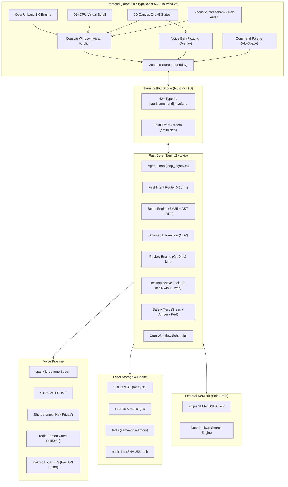

# FRIDAY — Full System Architecture, Codebase & Component Report
**Generated**: October 2026 | **Version**: 1.0.0 Production Release | **Target OS**: Windows 10 / 11 (64-bit)  
**Stack**: Tauri v2, Rust (2021 Edition), React 19, TypeScript 5.7, Tailwind CSS v4, Motion (Framer Motion 12), SQLite (`rusqlite` + `sqlite-vec`), ONNX Runtime / Sherpa.

---

## 1. Executive Summary & Philosophy

**FRIDAY** (*Female Replacement Intelligent Digital Assistant Youth*) is an intelligent, voice-first desktop operator for Windows. Inspired by the MCU persona of Kerry Condon, FRIDAY is composed, articulate, warm yet dryly witty, and razor-sharp.

### 1.1 The Voice-First Operating Rules
1. **The Utterance Contract**:
   - Every turn operates across two distinct, synchronized output channels:
     - **`say` (Spoken Channel)**: Natural, conversational audio prose. Maximum 2–3 sentences. **Zero URLs, zero file paths, zero bullet points, zero asterisks, zero raw markdown**.
     - **`show` (Visual Channel)**: Rendered on screen. Rich GitHub-flavored markdown, syntax-highlighted code blocks, tabular telemetry, interactive diff previews, or generative **OpenUI Lang 1.0** interactive widgets.
2. **Confirmation Safety Tiers**:
   - `Green`: Silent background execution, past-tense spoken narration (e.g., reading a file, searching code, listing windows).
   - `Amber`: Preview card rendered on screen, 1-sentence spoken confirmation, 8-second auto-timeout or "go ahead" confirmation (e.g., modifying non-critical workspace files, opening apps).
   - `Red`: Full diff/details preview on screen, requires explicit spoken or typed "confirm" before execution (e.g., file deletions, shell executions, directory modifications).
3. **Strict Latency Budgets**:
   - Non-verbal earcon acknowledgement: **≤ 150 ms**
   - Speech endpoint detection: **≤ 280 ms**
   - Intent routing: **≤ 15 ms**
   - Perceived end-to-end voice turn: **≤ 1.8 s (p95)**
   - Barge-in voice stop response: **≤ 200 ms**

### 1.2 The Three Design Laws (`AGENTS.md`)
- **Surface Law**: Every panel is a rounded rectangle on an 8px grid (`16px` radius for containers/cards, `8px` for controls). Surfaces sit on Mica (Windows 11) or Acrylic (Windows 10) dark plates. No decorative gradients except the 40px reactive Orb.
- **One-Signal Law**: A single accent color — `--color-acid: oklch(78% 0.19 152)` / `hsl(var(--signal))` — appears at most twice per viewport. It **only** signifies active work (listening, thinking, executing, streaming), never static chrome.
- **Sub-Frame Law**: Every transition is 120–220ms using `cubic-bezier(0.22, 1, 0.36, 1)`. Animations that drop below 60fps are deleted. `prefers-reduced-motion` collapses transitions to instant or opacity-only.
- **Banned Practices**: Zero inline styles (`style={{ ... }}` banned), zero `any` in TypeScript, zero `.unwrap()` outside `#[cfg(test)]` in Rust.

---

## 2. High-Level System Architecture Diagram



---

## 3. Repository Map & Directory Layout

```
c:\Users\anesx\Desktop\friday\
├── Cargo.lock
├── package.json                    # Scripts: dev, build, check, test, tauri
├── tsconfig.json                   # Strict TypeScript compiler configuration
├── vite.config.ts                  # Vite + React 19 + Tailwind CSS v4 bundler
├── AGENTS.md                       # Non-negotiable Constitution for FRIDAY
├── SYSTEM_ARCHITECTURE_REPORT.md   # [This Document] Full codebase specification
│
├── src/                            # Frontend (React 19 + TypeScript)
│   ├── main.tsx                    # React DOM entry point
│   ├── App.tsx                     # Top-level window router (Console, Bar, Palette, Onboarding)
│   ├── lib/                        # State, IPC, AI client, Voice, Virtual Scrolling
│   │   ├── ai.ts                   # Two-channel LLM turn executor & OpenUI generator
│   │   ├── bindings.ts             # Rust-to-TypeScript IPC interface declarations
│   │   ├── ipc.ts                  # Tauri command invoke bridge & browser fallbacks
│   │   ├── kokoro.ts               # Kokoro local TTS client (FastAPI / OpenAI audio endpoint)
│   │   ├── lenis.ts                # Custom 0% CPU idle virtual momentum scroll engine
│   │   ├── phrasebank.ts           # Sub-150ms instant non-verbal acoustic earcon player
│   │   ├── seed.ts                 # Offline seed state fixtures & demo datasets
│   │   ├── store.ts                # Unified Zustand store (reactive state & persistence)
│   │   ├── types.ts                # TypeScript domain models (Message, Thread, Fact, ToolCall)
│   │   ├── utils.ts                # Class merging utility (clsx + tailwind-merge)
│   │   ├── voice.ts                # Voice capture, native audio IPC, RMS audio stream
│   │   └── workflow.ts             # Multi-step automation execution engine
│   ├── components/                 # Reusable UI primitives & graphics engines
│   │   ├── intelligent-ui/         # Generative OpenUI Lang 1.0 interpreter & components
│   │   │   ├── IntelligentUIRenderer.tsx # Dynamic AST parser, state binder, and renderer
│   │   │   ├── parser.ts           # Tokenizer & recursive AST builder (supports [] & {})
│   │   │   ├── types.ts            # AST node interfaces (Node, Primitive, MapMarker)
│   │   │   ├── examples.ts         # Pre-baked OpenUI statement templates
│   │   │   └── primitives/         # Layout, Typography, Controls, DataVisuals, Media, Interactive
│   │   ├── motion/                 # Bencho & Argon tactile physics
│   │   │   └── MouseInteractions.tsx # PerspectiveTilt (3D), SpotlightSurface (Aura), SpringChip, Magnetic
│   │   ├── providers/              # Component wrappers
│   │   │   └── SmoothScroll.tsx    # Lenis virtual momentum scroll container with spring indicator
│   │   ├── orb/                    # 2D Canvas reactive Orb (0% idle CPU)
│   │   │   └── FridayOrb.tsx       # Idle, Listening, Thinking, Speaking, Reasoning canvas states
│   │   ├── telemetry/              # Telemetry & performance visualizers
│   │   │   └── AudioSpectrumVisualizer.tsx # 30fps capped audio RMS visualizer
│   │   ├── layout/                 # Layout backgrounds
│   │   │   └── AtmosphericField.tsx# Ambient halftone dot grid
│   │   ├── chat/                   # Chat UI Components
│   │   │   └── ChatHistorySidebar.tsx # Collapsible session history drawer (Today, 7 Days, Older)
│   │   └── ui/                     # Primitives (button, textarea, tooltip, empty)
│   └── surfaces/                   # Major surface viewports
│       ├── console/                # Primary desktop operating console
│       │   ├── Console.tsx         # Main frame with titlebar, Mica drag region, Rail, and active tab
│       │   ├── Rail.tsx            # Canonical 64px black instrument navigation rail
│       │   ├── ChatTab.tsx         # Operating surface chat stream, OpenUI renderer, composer
│       │   ├── ToolCallCard.tsx    # Lifecycle execution card for native tools (4-step tracker)
│       │   ├── BeastTab.tsx        # Two-stage code search, AST chunking, symbol inspector
│       │   ├── ProjectsTab.tsx     # Desktop workspace manager, file editor, archetype scaffolder
│       │   ├── BrowserTab.tsx      # Browser perception snapshot tree, click/type/scroll actions
│       │   ├── ReviewTab.tsx       # Git diff auditor, unwrap linter, security audit
│       │   ├── AutomationsTab.tsx  # Cron job scheduler, trigger runner, history
│       │   ├── MemoryTab.tsx       # Associative memory facts, confidence badges, editor
│       │   ├── SkillsTab.tsx       # Active skills toggle & trigger patterns
│       │   ├── DelphiTab.tsx       # Toolcraft / Delphi tools workbench & JSON schemas
│       │   ├── AuditTab.tsx        # Cryptographic hash audit trail of all executed commands
│       │   ├── SettingsTab.tsx     # Provider endpoints, API keys, models, wake word tuning
│       │   ├── BenchoWatermelonPrimitives.tsx # Watermelon UI cards, toggles, drawers, sliders
│       │   └── Inspector.tsx       # Context & memory inspector drawer
│       ├── bar/                    # Floating compact voice bar viewport
│       │   └── Orb.tsx             # Floating desktop pill with live transcript
│       ├── palette/                # Command Palette (`Alt+Space` / `Ctrl+K`)
│       │   ├── Palette.tsx         # Fuzzy search popup command palette
│       │   └── commands.ts         # Static & dynamically derived commands (threads, skills, tools)
│       ├── onboarding/             # First-launch onboarding modal & permissions wizard
│       └── landing/                # Standalone landing showcase
│
└── src-tauri/                      # Backend (Rust + Tauri v2)
    ├── Cargo.toml                  # Rust dependencies, compilation profile (thin LTO, opt-level 3)
    ├── tauri.conf.json             # Tauri window definitions, permissions, security capabilities
    ├── build.rs                    # Tauri build hook
    └── src/
        ├── main.rs                 # Tauri entry point
        ├── lib.rs                  # Core backend runner: window vibrancy, 42+ IPC commands
        ├── agent/                  # Reasoning & Autonomous Operators
        │   ├── loop_legacy.rs      # Agent turn execution, fast intent router, OpenUI synthesis
        │   ├── beast.rs            # Beast Engine code search, tree-sitter AST parser, RRF ranking
        │   ├── browser.rs          # Chrome DevTools Protocol automation & DOM snapshots
        │   ├── review.rs           # Git diff reviewer, unwrap scanner, AST auditor
        │   ├── machine.rs          # Agent execution state machine
        │   └── mcp_client.rs       # Model Context Protocol (MCP) client bridge
        ├── tools/                  # Native Desktop OS Tools
        │   ├── mod.rs              # Filesystem, shell, window manipulation, system diagnostics, web search
        │   ├── delphi.rs           # Delphi schema reflection
        │   ├── scaffold.rs         # Project archetype scaffolding (Rust, React, Python)
        │   └── security.rs         # Safety classification (Green/Amber/Red)
        ├── voice/                  # Audio Pipeline & Local Models
        │   ├── capture.rs          # cpal microphone stream & ringbuffer capture
        │   ├── phrasebank.rs       # Sub-150ms instant non-verbal acoustic earcons via rodio
        │   ├── wakeword.rs         # Local wake word detector ("Hey Friday")
        │   ├── hotwords.rs         # Phonetic boosting & phrase corrections
        │   ├── normalize.rs        # Text-to-speech phonetic normalizer
        │   ├── silero_vad.rs       # Silero voice activity detection
        │   └── playback.rs         # Audio playback stream
        ├── providers/              # LLM Inference Providers
        │   ├── glm.rs              # Zhipu GLM / DeepSeek / OpenAI SSE streaming client
        │   ├── router.rs           # Query classifier (Light fast model vs Heavy reasoning model)
        │   └── models.rs           # Provider manager, latency telemetry, model catalog
        ├── memory/                 # Persistence & Semantic Memory
        │   ├── db.rs               # SQLite database (threads, messages, facts, audit, automations)
        │   └── facts.rs            # Fact extraction, confidence scoring, cosine similarity search
        └── scheduler/              # Scheduled Tasks
            └── mod.rs              # Background cron scheduler
```

---

## 4. Backend Architecture Deep Dive (Rust / Tauri v2)

### 4.1 State & Execution Architecture (`src-tauri/src/lib.rs`)
The Tauri application initializes with:
- **Window Vibrancies**: Native Windows 11 Mica / Windows 10 Acrylic applied to `console` and `voice_bar` via `window-vibrancy`.
- **Global Shortcuts**:
  - `Alt+Shift`: Toggles voice listening turn.
  - `Alt+Space`: Opens or focuses the floating Command Palette (`palette`).
- **Tray Icon**: Windows system notification tray icon with status, show/hide shortcuts, and quit.
- **AppState Shared Structure**:
  ```rust
  pub struct AppState {
      pub agent: Arc<AgentCore>,
      pub kernel: Arc<crate::agent::machine::HarnessKernel>,
      pub audio_capture: Arc<AudioCaptureManager>,
      pub scheduler: Arc<SchedulerManager>,
      pub skills: Arc<SkillRegistry>,
  }
  ```

### 4.2 Complete Tauri IPC Commands Inventory

| Command Name | Arguments | Return Type | Description |
|---|---|---|---|
| `submit_utterance` | `utterance: String, mode: Option<String>` | `Result<TurnResult, String>` | Executes agent turn through `loop_legacy.rs` with fast intent router |
| `confirm_plan` | `plan_id: String` | `Result<PendingPlan, String>` | Approves an Amber or Red tier plan and executes its deferred actions |
| `undo_last` | *none* | `Result<String, String>` | Reverses the last executed reversible action |
| `start_mic_capture` | *none* | `Result<(), String>` | Activates `cpal` microphone audio capture thread |
| `stop_mic_capture` | *none* | `Result<(), String>` | Stops active microphone audio capture thread |
| `start_listening` | *none* | `Result<(), String>` | Alias for starting voice recognition turn |
| `stop_listening` | *none* | `Result<(), String>` | Stops voice recognition turn |
| `get_audio_rms` | *none* | `AudioRmsResponse` | Returns microphone input and audio output RMS levels for visualizers |
| `barge_in` | *none* | `Result<(), String>` | Cancels in-flight audio playback in ≤ 200ms when user speaks |
| `is_speaking` | *none* | `bool` | Checks if TTS playback or acoustic phrasebank is currently active |
| `speak_text` | `text: String` | `Result<(), String>` | Sends text to local Kokoro TTS engine for spoken playback |
| `start_wake_word` | *none* | `Result<WakeWordStatus, String>` | Starts local "Hey Friday" wake word listener |
| `stop_wake_word` | *none* | `Result<WakeWordStatus, String>` | Stops wake word listener |
| `get_wake_word_status` | *none* | `WakeWordStatus` | Retrieves active state of wake word detection |
| `set_wake_word_sensitivity` | `sensitivity: f32` | `Result<(), String>` | Updates wake word threshold (0.0 to 1.0) |
| `get_facts` | *none* | `Result<Vec<DbFact>, String>` | Retrieves associative memory facts from SQLite |
| `add_fact` | `content: String, confidence: Option<f32>` | `Result<DbFact, String>` | Inserts or updates a remembered fact with confidence score |
| `delete_fact` | `id: String` | `Result<bool, String>` | Deletes a remembered fact by UUID |
| `get_audit_log` | *none* | `Result<Vec<DbAuditEntry>, String>` | Fetches recent cryptographic security audit entries (limit 50) |
| `get_threads` | *none* | `Result<Vec<DbThread>, String>` | Fetches all conversation sessions from SQLite ordered by updated time |
| `get_active_thread` | *none* | `Result<String, String>` | Returns the active thread ID stored in settings |
| `create_thread` | `thread_id: Option<String>, title: Option<String>` | `Result<DbThread, String>` | Inserts new thread session with deterministic ID |
| `add_message` | `thread_id: String, role: String, say: Option<String>, show: Option<String>` | `Result<DbMessage, String>` | Persists a message record to SQLite |
| `delete_thread` | `thread_id: String` | `Result<bool, String>` | Cascades deletion of thread and its messages from SQLite |
| `rename_thread` | `thread_id: String, title: String` | `Result<bool, String>` | Updates thread title in SQLite |
| `toggle_thread_pin` | `thread_id: String` | `Result<bool, String>` | Toggles pinned boolean status of a thread |
| `set_active_thread` | `thread_id: String` | `Result<bool, String>` | Persists current active thread ID |
| `get_messages` | `thread_id: String` | `Result<Vec<DbMessage>, String>` | Retrieves all messages for a thread ordered chronologically |
| `get_automations` | *none* | `Result<Vec<DbAutomation>, String>` | Lists background scheduled cron workflows |
| `toggle_automation` | `id: String` | `Result<bool, String>` | Enables/disables a scheduled automation |
| `trigger_automation`| `id: String` | `Result<String, String>` | Executes a scheduled automation immediately |
| `get_skills` | *none* | `Result<Vec<DbSkill>, String>` | Lists registered tool skills and their trigger schemas |
| `toggle_skill` | `id: String` | `Result<bool, String>` | Toggles skill enablement |
| `get_glm_settings` | *none* | `Result<GlmSettingsDto, String>` | Retrieves active LLM provider configuration |
| `update_glm_settings`| `settings: GlmSettingsDto` | `Result<bool, String>` | Updates provider keys, model names, and base URLs |
| `search_code` | `query: String, path: Option<String>` | `Result<Vec<CodeSearchResult>, String>` | Ripgrep-based code search across workspace |
| `find_symbols` | `query: String, max_results: Option<usize>` | `Result<Vec<SymbolResult>, String>` | Tree-sitter AST symbol extractor |
| `rrf_search` | `query: String` | `Result<Vec<RrfRankedResult>, String>` | Beast two-stage hybrid Reciprocal Rank Fusion search |
| `read_file_content` | `path: String, max_lines: Option<usize>` | `Result<serde_json::Value, String>` | Reads file content safely |
| `list_directory` | `path: String` | `Result<Vec<serde_json::Value>, String>` | Lists files and subdirectories |
| `process_text` | `action: String, input: String` | `Result<serde_json::Value, String>` | Legacy text processing pipeline |
| `browser_snapshot` | `url: String` | `Result<BrowserSnapshot, String>` | Connects to Chrome DevTools Protocol to capture DOM & tree |
| `browser_action` | `action: BrowserAction` | `Result<BrowserActionResult, String>` | Performs click, scroll, or input on active browser page |
| `review_diff` | *none* | `Result<serde_json::Value, String>` | Analyzes git diff for constitution violations and unwraps |
| `review_scan` | *none* | `Result<serde_json::Value, String>` | AST code quality and security scan |
| `code_chunk` | `path: String` | `Result<Vec<CodeChunk>, String>` | Tree-sitter semantic AST code chunker |
| `capture_screen` | `target: Option<String>` | `Result<serde_json::Value, String>` | Native Windows.Graphics.Capture screenshot |
| `screen_ocr` | `image_base64: Option<String>` | `Result<serde_json::Value, String>` | Windows.Media.Ocr native local text extraction |
| `list_windows` | *none* | `Result<Vec<WindowInfo>, String>` | Enumerates visible top-level desktop windows |
| `focus_window` | `query: String` | `Result<bool, String>` | Brings matched desktop window to foreground |
| `set_window_state` | `query: String, state: String` | `Result<bool, String>` | Minimizes, maximizes, or restores a desktop window |
| `scan_desktop_repos`| *none* | `Result<Vec<DiscoveredRepoInfo>, String>` | Discovers git repositories on Desktop/Documents |
| `scaffold_project_archetype`| `archetype: String, target_dir: String, name: String` | `Result<ScaffoldResult, String>` | Scaffolds standard projects (Tauri, React, Python) |
| `inspect_project_tree`| `path: String, max_depth: Option<usize>` | `Result<Vec<ProjectFileNode>, String>` | Generates nested project directory tree |
| `read_project_file`| `path: String` | `Result<String, String>` | Reads project file text |
| `write_project_file`| `path: String, content: String` | `Result<bool, String>` | Writes text to a project file |
| `create_project_file_or_dir`| `path: String, is_dir: bool` | `Result<bool, String>` | Creates file or folder in workspace |
| `delete_project_path`| `path: String` | `Result<bool, String>` | Deletes file or directory safely |
| `execute_project_command`| `command: String, cwd: Option<String>` | `Result<CommandOutputDto, String>` | Runs shell command in project directory |
| `get_project_git_diff`| `project_path: String` | `Result<serde_json::Value, String>` | Returns staged and unstaged git diff |
| `commit_project_changes`| `project_path: String, message: String` | `Result<serde_json::Value, String>` | Commits workspace changes to git |
| `inspect_project_metadata`| `path: String` | `Result<ProjectMetadataDto, String>` | Reads package.json / Cargo.toml dependency metadata |
| `init_project_git` | `path: String` | `Result<String, String>` | Initializes a fresh git repository |
| `app_minimize` | *none* | `Result<(), String>` | Minimizes active Tauri window |
| `app_toggle_maximize`| *none* | `Result<bool, String>` | Toggles maximized state of active window |
| `app_is_maximized` | *none* | `Result<bool, String>` | Returns whether active window is maximized |
| `app_start_dragging`| *none* | `Result<(), String>` | Native custom titlebar dragging initiation |
| `app_close` | *none* | `Result<(), String>` | Gracefully hides or quits application |

### 4.3 Database Schema & Migrations (`src-tauri/src/memory/db.rs`)
Managed in SQLite with WAL mode enabled (`PRAGMA journal_mode = WAL`):
```sql
CREATE TABLE IF NOT EXISTS threads (
    id TEXT PRIMARY KEY,
    title TEXT NOT NULL,
    pinned INTEGER NOT NULL DEFAULT 0,
    created_at INTEGER NOT NULL,
    updated_at INTEGER NOT NULL
);

CREATE TABLE IF NOT EXISTS messages (
    id TEXT PRIMARY KEY,
    thread_id TEXT NOT NULL,
    role TEXT NOT NULL,
    say TEXT,
    show TEXT,
    latency_ms INTEGER,
    created_at INTEGER NOT NULL,
    FOREIGN KEY (thread_id) REFERENCES threads(id) ON DELETE CASCADE
);

CREATE TABLE IF NOT EXISTS facts (
    id TEXT PRIMARY KEY,
    content TEXT NOT NULL,
    confidence REAL NOT NULL DEFAULT 1.0,
    source_message_id TEXT,
    created_at INTEGER NOT NULL
);

CREATE TABLE IF NOT EXISTS audit_log (
    id TEXT PRIMARY KEY,
    tool_name TEXT NOT NULL,
    args_hash TEXT NOT NULL,
    tier TEXT NOT NULL,
    decision TEXT NOT NULL,
    duration_ms INTEGER NOT NULL,
    created_at INTEGER NOT NULL
);

CREATE TABLE IF NOT EXISTS automations (
    id TEXT PRIMARY KEY,
    name TEXT NOT NULL,
    cron TEXT NOT NULL,
    action TEXT NOT NULL,
    enabled INTEGER NOT NULL DEFAULT 1,
    last_run INTEGER
);

CREATE TABLE IF NOT EXISTS skills (
    id TEXT PRIMARY KEY,
    name TEXT NOT NULL,
    description TEXT NOT NULL,
    enabled INTEGER NOT NULL DEFAULT 1
);

CREATE TABLE IF NOT EXISTS settings (
    key TEXT PRIMARY KEY,
    value TEXT NOT NULL
);

CREATE INDEX IF NOT EXISTS idx_messages_thread ON messages(thread_id);
CREATE INDEX IF NOT EXISTS idx_messages_thread_time ON messages(thread_id, created_at);
```

### 4.4 Desktop Tools & Security Risk Classification (`src-tauri/src/tools/`)
Tools execute with strict safety tiering:
- **`Green`**: `fs.read`, `fs.list`, `win.list`, `sys.info`, `web.search`, `web.extract`. Silent execution with past-tense narration.
- **`Amber`**: `fs.write`, `win.focus`, `scaffold.project`, `browser.action`. Requires preview card and "go ahead" confirmation or 8s timeout.
- **`Red`**: `fs.delete`, `shell.exec`, `git.commit`. Requires full interactive diff and explicit user confirmation.

`web.extract` includes an anti-bot desktop Chrome `User-Agent` header, preventing Wikipedia HTTP 403 Forbidden blocks and Cloudflare scraping hangs.

---

## 5. Frontend Architecture Deep Dive (React 19 / TypeScript 5.7)

### 5.1 Unified Zustand State Store (`src/lib/store.ts`)
The entire frontend reactive state is centralized in `useFriday` (`useFridayStore`):

#### State Properties:
- `tab: ConsoleRoute`: Active surface route (`chat`, `projects`, `browser`, `automations`, `memory`, `review`, `skills`, `beast`, `delphi`, `audit`, `settings`).
- `orb: OrbState`: Orb animation state (`idle`, `listening`, `thinking`, `speaking`, `waiting`, `reasoning`).
- `threads: Thread[]`: All conversation threads with nested `messages: Message[]` and `pinned: boolean`.
- `activeThreadId: string | null`: Currently active conversation ID.
- `chatHistoryOpen: boolean`: Toggle for the sliding conversation history drawer.
- `utterance: Utterance`: Live speech-to-text transcript buffer (`partial`, `final`, `confidence`).
- `connectivity: Connectivity`: Network status (`online`, `offline`, `degraded`).
- `facts: Fact[]`: Synchronized memory facts from backend SQLite.
- `audioRms: { mic: number; output: number }`: Real-time audio RMS telemetry.

#### Core Actions:
- `createThread(initialTitle?)`: Instantiates fresh session, auto-switches active thread, persists via IPC.
- `setActiveThread(id)`: Changes active session, persists active thread ID to SQLite settings.
- `deleteThread(id)`: Purges thread from SQLite with cascading delete; auto-selects adjacent thread.
- `renameThread(id, title)`: Renames session title in memory and SQLite.
- `togglePinThread(id)`: Toggles pinned state and updates chronological ordering.
- `formatAutoThreadTitle(prompt)`: Sanitizes first message prompt on word boundaries with title casing (e.g. `"Whats the specs of the new surface…"`).
- `sendChatMessage(text, expanded)`: Triggers acoustic earcon cue, records user message, executes AI turn, updates UI, and triggers Kokoro TTS voice playback.
- `bargeIn()`: Stops audio playback and resets speech queue within 200ms.

### 5.2 Generative OpenUI Lang 1.0 Engine (`src/components/intelligent-ui/`)
FRIDAY interprets and renders generative UI widgets produced by the backend using **OpenUI Lang 1.0**:
- **Grammar & Lexer (`parser.ts`)**:
  - Supports variable declarations (`$varName = 50`).
  - Supports bracket array syntax: `Col([hero, specs])`.
  - Supports curly-brace block syntax: `root = Col(gap=16) { hero = Card(...) { ... } }`.
  - Supports multi-argument positional syntax: `Col(Title(...), Row(...), Grid(...))`.
- **AST Evaluator (`IntelligentUIRenderer.tsx`)**:
  - Dynamically evaluates child component nodes.
  - Resolves `Card` arguments dynamically (strings become titles/subtitles, AST objects become child components).
  - Handles stateful bindings between controls (e.g. `Slider`) and reactive text (e.g. `$interestRate`).
- **Primitives Inventory (`primitives/`)**:
  1. **Layout**: `Col`, `Row`, `Grid`, `Card`, `Carousel`, `Box`, `Divider`, `Spacer`.
  2. **Typography**: `Title`, `Text`, `Badge`, `List`, `ListItem`.
  3. **Controls**: `Slider`, `Button`, `SegmentedControl`, `Checkbox`, `Timer`.
  4. **Data Visuals**: `MapView` (Leaflet map with pins), `Chart` (SVG bar/line), `Metric` (KPI indicator with trend).
  5. **Media**: `Image`, `SearchImage` (responsive Unsplash fallback CDN).
  6. **Interactive**: `Flashcard` (3D flip physics), `Celebration` (confetti particles), `Table` (sortable tabular data).

### 5.3 Tactile Physics & Mouse Motion (`src/components/motion/MouseInteractions.tsx`)
- **`PerspectiveTilt`**: 3D perspective (`1000px`) card tilt mapped to cursor proximity (`stiffness: 320, damping: 28`).
- **`SpotlightSurface`**: Smooth radial gradient aura following cursor coordinates with spring smoothing (`stiffness: 450, damping: 32`).
- **`Magnetic`**: Micro-pull on buttons and interactive chips (`pullFactor: 0.28`).
- **`SpringChip`**: Tactile spring-scaled chips for quick action selection.

### 5.4 0% CPU Momentum Smooth Scrolling (`src/components/providers/SmoothScroll.tsx`)
- Encapsulates `src/lib/lenis.ts` virtual scroll math.
- Damps mouse wheel delta into exponential inertia decay.
- Automatically sleeps `requestAnimationFrame` when delta velocity drops below `0.001` (0% CPU at idle).
- Collapses to instant scrolling when `prefers-reduced-motion` is active.

### 5.5 2D Canvas Reactive Orb (`src/components/orb/FridayOrb.tsx`)
- 40px reactive circle rendered via 2D Canvas API.
- 5 Visual States: `idle`, `listening`, `thinking`, `speaking`, `reasoning`.
- **Strict 0% Idle CPU Law**: Shuts off `requestAnimationFrame` when state is `idle`.

---

## 6. Console Surfaces & Navigation Tabs

1. **`ChatTab.tsx`**:
   - Central conversational surface with 760px editorial column.
   - Collapsible tool status pills (`CollapsibleToolCalls`): groups multiple tools into a compact summary (`✓ 3 tools executed · 1.2s ⌄`).
   - `ToolCallCard.tsx`: 4-step progress indicator (`Queued`, `Running`, `Verifying`, `Complete`) with sanitized error messages.
   - Interactive Plan Confirmation cards (Green, Amber, Red).
   - Fixed prompt composer with microphone trigger and attachment support.
2. **`ChatHistorySidebar.tsx`**:
   - 260px collapsible session drawer (`Ctrl+H` toggle).
   - Live title search filter.
   - Chronological categories: `Pinned`, `Today`, `Yesterday`, `Previous 7 Days`, `Older`.
   - Inline double-click title renaming and pin toggling.
3. **`ProjectsTab.tsx`**: Workspace explorer, file editor, git diff viewer, and project archetypes generator.
4. **`BeastTab.tsx`**: Beast two-stage hybrid code search (BM25 lexical + vector semantic) and tree-sitter AST symbol extractor.
5. **`BrowserTab.tsx`**: Chrome DevTools Protocol visual DOM snapshot inspector and browser automation runner.
6. **`ReviewTab.tsx`**: Git diff security auditor and constitutional unwrap linter.
7. **`AutomationsTab.tsx`**: Scheduled cron workflows manager.
8. **`MemoryTab.tsx`**: Associative semantic memory editor with confidence scoring.
9. **`SkillsTab.tsx`**: Skills registry and execution trigger toggles.
10. **`DelphiTab.tsx`**: Toolcraft workbench and JSON schema explorer.
11. **`AuditTab.tsx`**: Cryptographic SHA-256 audit log of all desktop commands.
12. **`SettingsTab.tsx`**: Multi-provider AI selector, Kokoro TTS endpoint, and wake word sensitivity tuner.

---

## 7. Resources & External Dependencies Used

| Resource Category | Name / Identifier | Location / Endpoint | Purpose |
|---|---|---|---|
| **Local Database** | SQLite 3 (WAL mode) | `%APPDATA%/com.friday.app/friday.db` | Persistent sessions, messages, memory facts, audit logs |
| **Local Speech Engine** | Kokoro TTS | `http://localhost:8880/v1/audio/speech` | Neural voice synthesis (`af_bella` / `af_sky`) |
| **Local VAD** | Silero VAD ONNX | Bundled ONNX runtime | Sub-280ms voice activity endpoint detection |
| **Local Wake Word** | Sherpa-onnx | Bundled model weights | Zero-cloud "Hey Friday" local wake word detection |
| **Cloud LLM API** | Zhipu GLM-4 | `https://open.bigmodel.cn/api/paas/v4/` | Sole cloud brain for reasoning and OpenUI synthesis |
| **Web Search** | DuckDuckGo HTML | `https://html.duckduckgo.com/html/` | Sub-1.2s private web and hardware spec searches |
| **OS Graphics API** | Windows.Graphics.Capture | WinRT / Win32 API | Native zero-latency desktop screen capture |
| **OS OCR API** | Windows.Media.Ocr | WinRT API | Local offline optical character recognition |
| **OS Audio API** | cpal + rodio | Native WASAPI / DirectSound | Microphone stream capture and earcon audio playback |
| **Media Assets** | Unsplash Source CDN | `https://images.unsplash.com/` | Dynamic fallback photography for OpenUI carousels/cards |

---

## 8. Automated Verification Suite & Packaging

### 8.1 Test Verification Matrix
```bash
# 1. Rust Unit & Integration Tests (62 tests passed)
cargo test --manifest-path src-tauri/Cargo.toml --lib

# 2. Vitest Frontend Suites (70 tests passed across 3 test suites)
npx vitest run

# 3. TypeScript Strict Typecheck (0 errors)
pnpm check # runs tsc --noEmit

# 4. Vite Production Bundle (0 errors)
pnpm build # runs tsc && vite build

# 5. Standalone Release Binary Compilation
pnpm tauri build --no-bundle
```

### 8.2 Production Executable
- **Target Path**: `src-tauri/target/release/friday.exe`
- **Compiler Optimizations**: `opt-level = 3`, `lto = "thin"`, `codegen-units = 1`, `panic = "abort"`, `strip = true`.
- **Runtime Model**: Standalone offline-capable desktop binary with bundled Vite frontend, native Windows Mica vibrancies, and embedded SQLite engine.
