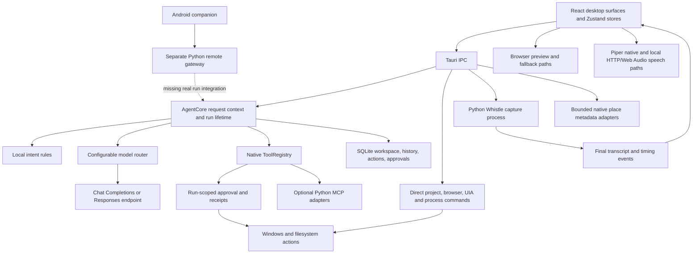

# FRIDAY: project scope, engineering audit, and development priorities

**Audit date:** 26 October 2026, Africa/Lagos.  
**Repository baseline:** `8f45493139de696834096983457f507936a7a3e4`, plus the substantial existing uncommitted working tree.  
**Purpose:** assess what FRIDAY is trying to become, what the implementation actually supports, what could undermine it, and how to turn the current work into a dependable product.  
**Important distinction:** sections 1–16 describe the audited baseline. Subsequent implementation and verification are recorded in section 17; a finding in the baseline is not automatically a statement about the final code after that work.

## 1. Executive assessment

FRIDAY is an ambitious Windows desktop operator with a substantial working foundation. It combines a React desktop interface, native Rust commands, configurable language-model providers, local speech components, persistent conversations and projects, a map workspace, reminders, developer tools, and an Android companion prototype.

**My assessment is that the repository is a development prototype with several well-engineered subsystems, rather than a release-ready autonomous operator.** This is an engineering judgment based on the execution paths and verification below, not a percentage-complete estimate. A single percentage would conceal major differences between the maturity of the workspace, speech, security, and spatial features.

The most promising parts are the persistent project/workspace model, provider configuration and credential isolation, native run records, plan-bound approvals, file undo receipts, and bounded place-data adapters. These provide a credible base for a useful daily assistant.

The biggest problem is **the gap between displayed certainty and demonstrated execution**. Some features report that they acted or verified something when the relevant implementation only returns a canned result. Other code paths can perform real desktop mutations without passing through the newer approval and receipt system. That combination matters more than adding another visible feature.

The next development phase should make a small set of end-to-end workflows dependable: understand a request, capture its context, preview consequences, execute within authority, verify the result, persist the evidence, and recover honestly after failure. The larger companion and spatial vision can grow from that foundation.

Nothing in this repository can establish whether the project will determine your career or financial future. What engineering can establish is whether the product is useful, safe to trust, reproducible, and measurably improving. The plan below is intended to make those decisions concrete.

## 2. Scope and method

### 2.1 What was examined

The audit inventoried **335 source/test/script files containing 69,963 lines** across `src`, `src-tauri/src`, `core`, `tests`, `scripts`, `bench`, and Android application sources. This count excludes CSS, Markdown, notebooks, dependencies, generated output, neural weights, and vendored libraries. It is a source inventory, not a claim that every line received equal scrutiny.

The review traced the main application and command paths, inspected the highest-impact persistence, execution, speech, provider, monitoring, and remote-access implementations, sampled supporting components, examined the test strategy, and ran fresh checks. Earlier work notes were treated as historical context rather than proof.

The governing requirements are [AGENTS.md](../AGENTS.md), with the existing visual identity in [DESIGN.md](../DESIGN.md). Other architecture documents were used to reconstruct the intended scope. Where an older blueprint conflicts with the constitution—for example, its old green accent—the constitution takes precedence.

### 2.2 Evidence labels

| Label | Meaning |
|---|---|
| Verified by command | A fresh command completed and its output was inspected. |
| Reproduced in isolation | A narrowly scoped harness exercised the actual relevant implementation without a live desktop action. |
| Confirmed in source | The behavior is directly visible in an inspected execution path; a live user journey was not performed. |
| Partial | Meaningful code exists, but part of the intended behavior or integration is missing. |
| Unverified | The audit did not establish the behavior on a running installed application. |
| Simulated/unavailable | The relevant path returns example data, canned outcomes, or an explicit unavailable response. |

### 2.3 Limits of this audit

This is a broad repository and architecture audit, not a penetration-test certification, a complete formal review, or a user acceptance sign-off. It did not access provider secrets, inspect your personal database contents, record microphone/camera input, terminate processes, install software, retrain a model, or run destructive desktop commands.

No browser automation connector or installed Playwright package was available during the baseline audit. Native UI journeys, accessibility behavior, audible speech quality, physical barge-in timing, clean-machine installation, and a sustained native resource soak remain unverified. The available Python suite was collected without executing its potentially external/desktop-dependent scenarios.

## 3. The actual product scope

The documents describe several related products inside one repository:

| Product layer | Intended user value | Recommended place in the roadmap |
|---|---|---|
| Voice-first Windows assistant | Speak requests, receive immediate feedback, interrupt speech, perform common actions. | Core product. |
| Trusted action engine | Plans, permissions, cancellation, verification, undo, durable history. | Required foundation for every operator capability. |
| Personal work/project workspace | Tasks, notes, reminders, project instructions, continued conversations, contextual assistance. | Strong initial daily-use focus. |
| Coding assistant | Inspect a repository, edit files, run commands, inspect changes, verify work. | Bounded second-stage workflows. |
| Browser/computer control | Act on real webpages and native controls. | Expand only behind verified adapters and action permissions. |
| Memory-rich companion | Remember preferences and work history, offer appropriate suggestions. | Incremental; provenance and correction precede broad inference. |
| Spatial command environment | Maps, places, imagery, systems data, cameras. | Preserve the existing UI; separate sourced information from demonstrations. |
| Autonomous multi-agent system | Delegate, coordinate dependencies, verify and combine results. | Later expansion; current Legion does not supply this capability. |
| Mobile remote operator | Pair a phone, send voice requests, inspect status, authorize actions. | Optional extension after authentication and desktop-run integration. |

This breadth explains why the project feels large. Each layer brings its own correctness and operating requirements. A reliable voice operator plus workspace is already a substantial product; it does not need worldwide telemetry or autonomous swarms to justify daily use.

### Recommended initial promise

> A Windows assistant that helps me work through my projects by voice, remembers the context I choose, performs reviewed actions, and shows exactly what changed.

This promise matches the strongest existing implementation. The exact first customer and commercial positioning still need user research; the repository alone does not establish demand or willingness to pay.

## 4. Architecture: what actually runs

The important architectural distinction is the `Direct` path. The new run system improves tools invoked within `CURRENT_RUN`, but several exposed commands directly modify the system. They do not inherit the same approval, context, cancellation, or inverse-receipt guarantees.

The primary execution authority is `AgentCore`, implemented largely in [loop_legacy.rs](../src-tauri/src/agent/loop_legacy.rs) and wrapped by [runs.rs](../src-tauri/src/agent/runs.rs). Despite the filename, this is active code. The Python `HarnessKernel`/LangGraph graph is not the primary desktop executor: startup explicitly treats Python as an optional, lazily initialized adapter in [lib.rs](../src-tauri/src/lib.rs), lines 2204–2211.

### Architecture strengths

- The desktop backend uses native Rust/Tauri rather than relying exclusively on browser privileges.
- Requests capture thread, project, and provider selection, reducing response attribution errors when the user changes views.
- SQLite stores workspace data and execution records; startup marks unfinished runs interrupted instead of blindly replaying side effects.
- Model endpoints and exact model names remain configurable. Naming a module `glm` does not mean the current product is restricted to GLM.
- Native place adapters already demonstrate useful boundaries: approved destinations, response-size limits, timeouts, concurrency controls, cancellation, and stale-cache metadata.
- The frontend already lazy-loads many console surfaces, and the static contour core avoids an idle animation loop.

### Architecture weaknesses

- Execution policy is not a universal boundary across all native commands and adapters.
- Important files have accumulated multiple responsibilities: the main agent file has 3,944 lines; the tool registry 3,155; IPC/application setup 2,543; the frontend store 1,632.
- Multiple speech paths and legacy compatibility layers make readiness, playback state, and interruption difficult to reason about.
- Handwritten IPC/data contracts span Rust, TypeScript, Python, and Kotlin. TypeScript compilation alone cannot prove they agree at runtime.
- The `HarnessKernel` state machine itself has only `Idle` and `Processing`; the richer durable state exists elsewhere. The reference harness specification is much more ambitious than the integrated implementation.

## 5. Capability and maturity matrix

| Area | Baseline status | Evidence and practical limitation |
|---|---|---|
| Desktop shell and navigation | Implemented; runtime unverified | React/Tauri shell, fullscreen modes, tabs, local fonts and design tokens exist. |
| Typed chat through native provider | Implemented | Routed request and response paths exist; transport failure classification needs correction. |
| Provider profiles | Implemented with automated coverage | Per-profile credentials, exact model names, local/remote endpoints, and API dialect selection. |
| Responses transport | Stronger validation than legacy chat transport | Tests cover fragmented transport, tool IDs, HTTP failures, and incomplete responses. |
| Visible model token streaming | Incomplete | Main native loop supplies `|_delta| {}` callbacks and waits for completion. |
| Local intent routing | Implemented as rules | Useful deterministic commands; not evidence of a measured bge kNN routing pipeline. |
| Local microphone recognition | Partial | Whistle process, bounded queues, startup timeout, levels, metrics, final transcription. |
| Live partial transcription | Unavailable in current adapter | `partial_available=False` at daemon readiness. |
| Wake word | Explicitly unavailable | `start_wake_word` returns an error; `WakeWordUnavailable` backs the capture manager. |
| Local speech synthesis | Implemented paths, acceptance unverified | Native Piper plus local HTTP/Web Audio fallback. Assets/runtime discovery and cancellation need hardening. |
| Voice contract | Partial | Heard/Plan/Doing/Result component exists; plan completeness, risk propagation, and live ASR are incomplete. |
| Approvals | Implemented within run-scoped tool execution | Single-use, plan-bound, expiry-aware database checks; direct-command coverage incomplete. |
| Undo | Implemented for a bounded subset | Persistent receipts for file writes and file moves, 16 MB limit, byte-conflict checks. Not general rollback. |
| Run history and restart handling | Implemented | Ordered events and interruption records; successful-result semantics and reconciliation UI need work. |
| Projects/tasks/notes/Today | Implemented with partial integration risks | Native storage, project presets, selected note context; write-queue recovery bug reproduced. |
| Reminders | Implemented with unit coverage | IANA timezones and once/daily/weekdays; delivery while app is closed is not established. |
| Fact memory | Implemented, mostly heuristic | Simple extraction and retrieval; provenance, contradiction management and scoping need expansion. |
| Semantic response cache | Implemented, unsafe scope assumptions | Prompt-only matching can reuse answers across contexts and time. |
| Code search/review | Implemented bounded utilities | Text/symbol heuristics and review rules; full semantic language-server intelligence not established. |
| Native browser snapshots | Partial | HTTP fetch and HTML parsing, not a live authenticated browser DOM. |
| Native browser actuation | Simulated | Click returns success; fill/select change a cached record, not an actual page. |
| Native UIA observation | Partial | Cursor element and focused-window inspection exist. |
| Native UIA actuation | Simulated | Supported actions return `Ok(true)` without invoking Windows control patterns. |
| Legion swarm | Simulated | Four sleeps and canned conclusions, no actual dependency-aware workers. |
| Overwatch | Partial | Pattern detection on supplied text, not proven continuous monitoring and repair. |
| Places/search/photos/maps | Implemented with automated coverage | Real provider adapters and attribution support; external freshness and availability need runtime verification. |
| Planetary/process telemetry | Mixed; major feeds simulated | Fixed network/process, satellite, vessel and geospatial samples coexist with real map sources. |
| Hardware health | Partial, with truthful unknown values | Native resource sampling exists; missing GPU sensors use null rather than invented capacity. |
| Cameras | Partial | Webcam/browser-playable feeds, IndexedDB recordings and limits; no general RTSP/NVR capability. |
| Skills | Manifest discovery and permission checks | Runtime entry execution and consistently scoped permissions are not established. |
| Python tool adapters | Mixed | Importable integration scaffolding, external services and some stubs; not independently accepted. |
| Android companion | Prototype | Client UI/networking exists; remote commands are simulated and security is inadequate. |
| Training/export pipeline | Implemented scripts, model quality unverified | QLoRA/GGUF tooling and dataset generation exist; no held-out action reliability evidence established. |
| Distribution/update system | Incomplete | Packaging config exists; clean installation, signing, updates and rollback are not verified. |

## 6. Priority findings

Severity is based on potential impact and the inspected path. “Critical” does not mean exploitation occurred; it means the feature must not be relied on in the relevant deployment state until corrected.

### F01 — Critical: example process IDs can reach real process termination

**Evidence:** [net_telemetry.rs](../src-tauri/src/tools/net_telemetry.rs), lines 88–127, constructs a fixed list of process IDs and connections. `get_network_telemetry` exposes that list in [lib.rs](../src-tauri/src/lib.rs), lines 816–821. [EntityDossierDrawer.tsx](../src/surfaces/os/EntityDossierDrawer.tsx), lines 66–78, sends the selected PID to `terminate_process_socket`. The native handler calls `taskkill /F /PID` using that PID.

**Impact:** an example PID may coincide with an unrelated real process. The provided process name is logged, not verified against the actual process identity. The action is process termination, even though some wording suggests termination of an individual socket. The slider also does not satisfy the constitution's explicit spoken/typed Red confirmation requirement.

**Required correction:** disconnect sample telemetry from executable controls immediately. A future real process action needs current OS enumeration, process identity/start-time validation, an explicit plan-bound Red confirmation, protected-process checks, and a persisted result.

**Acceptance:** a sample record can never invoke termination; mismatched or recycled PID identity is refused; cancellation/expired confirmation performs no action.

### F02 — Critical when enabled: remote gateway does not enforce authentication

**Evidence:** [remote_gateway.py](../scripts/remote_gateway.py), lines 323–338, exposes `/api/screen` without authentication and adds unknown WebSocket tokens to the accepted set. The landing page includes the current pairing PIN. The service defaults to `0.0.0.0`; CORS permits all origins. Its persisted pairing configuration is a tracked repository file. No current credential values were copied into this report.

**Impact:** a reachable gateway can reveal desktop screenshots and telemetry to an unpaired client. The baseline query handler is simulated, so this audit does not claim arbitrary remote desktop execution through it. Adding real actions without first fixing authentication would enlarge the impact.

**Observed environment:** no listener on port 18420 was found during the baseline port check. This limits the immediate exposure observed on this machine; it does not fix the code.

**Required correction:** reject missing/unknown credentials before accepting WebSockets; authenticate screen endpoints; keep pairing secrets on a trusted local interface; constrain origins; support expiry/revocation; remove runtime credential state from version control. Use secure transport for remote access.

**Acceptance:** unauthenticated screenshots fail, invalid WebSockets are rejected, revoked tokens fail, and pairing information is not disclosed to arbitrary remote visitors.

### F03 — High: direct desktop mutations bypass the new action policy

**Evidence:** [lib.rs](../src-tauri/src/lib.rs), lines 1731–1815, exposes arbitrary project-file reads/writes, recursive deletion, and PowerShell command execution. These handlers do not accept a plan-bound approval or persist an inverse receipt. `delete_project_path` uses `remove_dir_all`/`remove_file`, contradicting the README's universal Recycle Bin claim.

In [tools/mod.rs](../src-tauri/src/tools/mod.rs), lines 1630–1645, the registry applies approval/receipt logic only when task-local run context exists; otherwise it invokes the unchecked implementation after schema validation.

**Impact:** a manual IDE action and an agent action have different guarantees. It is not sufficient to say that “all destructive actions require confirmation and support undo.” Frontend controls alone are not the enforcement boundary.

**Required correction:** distinguish explicit user editing from agent authority, but require appropriate native policy for both. Use bounded, canonical resource scope, action IDs, reliable outcomes, and honest reversibility. Audit every exported mutating command.

### F04 — High: a temporary workspace save failure poisons subsequent saves

**Evidence:** [workspace-native.ts](../src/lib/workspace-native.ts), lines 24–34, chains new writes with `pendingWrites.then(write)` and rethrows a previous rejection. After one failure, subsequent `.then(write)` callbacks never execute.

**Reproduction:** an isolated harness transpiled the actual module, injected a first failed write, and queued a second valid write. The output contained only the first execution; the second never ran; `flushWorkspaceWrites()` remained rejected. See `scratch/audit-2026-10-26/workspace-queue.json`.

**Impact:** one transient storage error can block later project/place saves and chat submission, because chat waits for the same queue. Recovery requires more than showing an error message.

**Required correction:** retain the original error for dependent actions while allowing an explicit retry/recovery to make progress. Avoid silently discarding a failed write and then advertising all context as saved.

**Acceptance:** fail one write, restore the backend, retry it, save another record, and submit a request; no write disappears, and failure remains visible until reconciled.

### F05 — High: provider failures can be persisted as completed runs

**Evidence:** the first provider failure in [loop_legacy.rs](../src-tauri/src/agent/loop_legacy.rs), lines 1900–1924, produces an error message inside `Ok(TurnResult)`. [runs.rs](../src-tauri/src/agent/runs.rs), lines 208–214, treats a non-pending `Ok` as `Completed`. The frontend also defaults to a completed plan when `failed` is absent.

**Impact:** the user may read an error while history says completed. Failure-rate telemetry, retries, and future autonomy become unreliable.

**Required correction:** use an explicit terminal outcome or propagate the error through the request boundary. Keep a user-friendly explanation while recording `Failed`; distinguish partial execution from total failure.

**Acceptance:** unreachable provider, invalid credentials, interrupted stream, tool failure, and exhausted execution budget cannot be reported as successful completion.

### F06 — High: Chat Completions streaming can accept an incomplete response

**Evidence:** [glm.rs](../src-tauri/src/providers/glm.rs), lines 516–527, breaks on an SSE read error. Lines 591–618 then repair accumulated tool arguments and emit tool calls and `Done`, without requiring a valid terminal completion marker. The separate Responses transport already has stronger incomplete-response checks.

**Impact:** partial text may be presented as a finished answer. Worse, a truncated tool argument buffer can be repaired into something executable if schema validation accepts it. Schema shape does not establish that it is the intended completed action.

**Required correction:** reject interrupted/malformed streams; require valid provider terminal semantics; never repair a truncated action into authority to execute. Preserve partial text only as explicitly incomplete display data.

**Acceptance:** a local fixture server that disconnects mid-text or mid-tool-call produces failure and zero executable calls.

### F07 — High: browser and UIA operations claim success without acting

**Evidence:** [perception.rs](../src-tauri/src/agent/perception.rs), lines 177–196, returns `Ok(true)` for click/focus/type without actual actuation. [browser.rs](../src-tauri/src/agent/browser.rs), lines 296–340, reports clicks and changes cached field values, with no browser controller performing them.

**Impact:** FRIDAY can say it completed an action when nothing changed. This damages trust and can cause the user to skip necessary work.

**Required correction:** return an explicit unavailable response until a real adapter exists. Future implementation must bind targets to fresh observations, use platform control APIs, and verify the resulting state.

### F08 — High: Legion is a visualization demonstration, not autonomous delegation

**Evidence:** [legion.rs](../src-tauri/src/agent/legion.rs), lines 158–215, runs fixed delays and returns strings such as a security audit passing. The declared dependencies are not used to gate worker execution. There are no model calls, source inspections, or actual audits in these workers.

**Impact:** the display makes evidence claims it has not earned. The existing tests mainly confirm the shape of this demonstration.

**Required correction:** label or disable the demonstration in production. Actual delegation needs bounded tasks, real tool/model execution, dependency handling, cancellation, ownership, merge/conflict policy, and a verifier.

### F09 — High: the local “sandbox” is an ordinary host process

**Evidence:** [sandbox_e2b.py](../core/tools/sandbox_e2b.py) silently falls back from E2B errors to `subprocess.run([sys.executable, temp_file], ...)`. A temporary working directory and a 15-second timeout do not restrict filesystem, network, credentials, or subprocess access.

**Impact:** the UI/tool description can imply isolation while generated code runs with the desktop user's privileges. Cloud sandbox failure must not silently widen authority.

**Required correction:** make backend choice explicit and fail closed when the requested sandbox is unavailable. A reviewed local execution mode may exist, but it must describe its actual privileges and have cancellation/process-tree control.

### F10 — High for voice acceptance: speech budgets are not demonstrated

**Evidence:** the current capture adapter emits final transcripts only and has no working wake word. Each new capture launches a process and constructs `needle.Whistle()`. Native Piper generates a complete result before handing samples to playback. In [lib.rs](../src-tauri/src/lib.rs), lines 666–674, synthesis and stop acquire the same mutex; stop cannot acquire it while synchronous synthesis holds it.

**Impact:** cold-start behavior, true time to first audio, and interruption during synthesis cannot be inferred from constants or stop-on-idle unit tests. The native speech helper can also report success with zero generated samples after fallback exhaustion.

**Required correction:** settle on one canonical speech lifecycle; warm local assets deliberately; expose missing capabilities; separate cancellation from the synthesis lock; measure audio-start and audio-stop at the output, not only function-call duration.

### F11 — High: response cache ignores conversational and project context

**Evidence:** [semantic_cache.rs](../src-tauri/src/memory/semantic_cache.rs) keys exact matches by normalized prompt and fuzzy matches by token overlap. It does not include project, conversation, provider, memory version, or source freshness. [loop_legacy.rs](../src-tauri/src/agent/loop_legacy.rs), lines 513 onward, can reuse this response for non-complex requests.

**Impact:** the same short question in a different project can receive an earlier answer. Current-status answers can become stale. The cache normalizes punctuation, which can erase meaningful distinctions in code or quantities.

**Required correction:** restrict caching to explicitly reusable, context-independent responses or include a validated context/freshness key. Never substitute cached prose for performing an action or verifying current state.

### F12 — High: ungrounded “verified” language appears beyond demonstrations

**Evidence:** [loop_legacy.rs](../src-tauri/src/agent/loop_legacy.rs), lines 480–507, can answer a presence follow-up with “Verified Present” based on words in the previous assistant answer rather than a new filesystem observation. Lines 2130–2137 can produce a generic “checked” response when a loop ends without useful results. The web-search fallback in [tools/mod.rs](../src-tauri/src/tools/mod.rs), lines 2997–3004, reports success after dispatch without retrieved evidence.

**Required correction:** define success from observable postconditions, not persuasive copy or the fact that a request was attempted. This should be a repository-wide outcome policy.

### F13 — Medium/high: model performance numbers are partly estimates presented as measurements

**Evidence:** [router.rs](../src-tauri/src/providers/router.rs), lines 226–229, derives TTFT as `max(total_ms / 3, 50)`. The agent estimates tokens from whitespace count plus 25. Frontend mapping also supplies default timing/token values when absent.

**Impact:** dashboards cannot establish p95 latency, cost, or regression performance from these values.

**Required correction:** timestamp the first actual output event, consume provider usage where available, and represent missing values as unknown. Keep estimates explicitly labeled and out of measured acceptance metrics.

### F14 — Medium/high: clean checkout and clean installation are not reproducible yet

**Evidence:** `Cargo.toml` uses a local `../vendor/sherpa-onnx/...` dependency while `vendor/` is ignored and absent from tracked source. Model directories are also ignored. Tauri bundles selected scripts/models, but no self-contained Python speech runtime or complete optional MCP environment is established. `core/requirements.txt` contains 15 NUL bytes and does not serve as a complete pinned speech manifest.

**Impact:** successful compilation on this machine does not prove another machine can build or run FRIDAY. Development-machine search paths can conceal missing packaged resources.

**Required correction:** document and automate a pinned bootstrap; verify downloads and licenses; package or explicitly provision required speech dependencies; test a clean Windows account and clean checkout.

### F15 — Medium: test names overstate the level of integration

**Evidence:** [core-journeys.test.ts](../tests/e2e/core-journeys.test.ts) operates on Zustand state and mocks, rather than driving a browser/native app. A perception test asserts that a result is either `Ok` or `Err`, which cannot establish successful perception. Camera tests include assertions on locally declared example arrays. [test_deepeval.py](../core/tests/test_deepeval.py) ends with `assert True`; the actual evaluation is commented out.

**Impact:** passing counts are useful for regressions in tested code, but they do not demonstrate successful desktop work, accuracy, or safety. The overall count must not be used as a completion score.

**Required correction:** retain useful unit tests, rename them honestly, and add real acceptance journeys and adverse-condition tests at the runtime boundaries.

### F16 — Medium: project rules and visual implementations have drifted

**Evidence:** the static scan found 67 JSX `style` occurrences and one confirmed explicit TypeScript `any` cast in [MotionCard.tsx](../src/components/motion/MotionCard.tsx), line 67. The 67 is a lexical occurrence count, not a count of user-visible defects. Some components are unused/library remnants. Active source also includes 500 ms flashcard transitions, color/all-property transitions, and non-token palette colors.

The violet `--color-acid` value is preserved. The current contour core is static, and the `FridayOrb` wrapper pauses in idle. These are positive facts; a blanket claim that the orb always spins would be incorrect. Whole-app idle CPU is still unmeasured, and periodic polling is not literally zero CPU.

**Required correction:** apply the constitution to active production components first, establish automated checks, and resolve conflicting dimensions in old design documents. Preserve the existing identity rather than using cleanup as a reason for another redesign.

### F17 — Medium: broad subscriptions and eager heavy imports can undermine responsiveness

**Evidence:** `App` subscribes to the whole Friday store while audio and execution updates can arrive frequently. It eagerly imports the spatial shell; the baseline Vite build emitted a 1,901.35 kB minified main chunk, 549.70 kB gzip, and a size warning.

**Impact:** this is a bundle and render-risk observation, not proof of a measured frame-rate failure. It warrants profiling, targeted selectors, and loading spatial/map code only when required.

### F18 — Medium: memory correctness needs stronger semantics

**Evidence:** name extraction accepts broad “I am …”/“I'm …” patterns; only a small adjective/verb exclusion list prevents accidental identity extraction. Fact IDs in some write paths use seconds. Some database write errors are ignored while a saved outcome is returned. The schema lacks the richer provenance/validity/contradiction model described by the harness reference.

**Required correction:** prefer explicit memory instructions, stable unique IDs, checked persistence, user correction, scope, and provenance. Evaluate multilingual and ordinary conversational counterexamples. Do not describe keyword matching or Jaccard matching as neural semantic reasoning.

### F19 — Medium: remote companion behavior is not integrated with desktop execution

**Evidence:** the gateway query handler waits, emits a completed plan, and says `Executed: ...` without calling `AgentCore`. Confirmation handlers clear a message rather than consuming native run approvals. The Android client uses cleartext traffic support and query-string tokens; a connection log includes the WebSocket URL. Legacy Android tests reference names not found in the reviewed main sources.

**Required correction:** authenticate first, then bridge every query and confirmation to the same native run IDs and policy as the desktop. Do not maintain a second independently authoritative execution system.

### F20 — Medium: release claims, licenses, and operational documentation need reconciliation

The README calls the product v2.0 while package/native manifests use 1.0.0. Different documents cite different historical test totals and absolute performance claims. An accepted signing/update ADR is not the same as an operational signing pipeline. No tracked root LICENSE or CI workflow was found in the baseline listing, despite an Apache-2.0 README claim.

Before distribution, inventory third-party source, model and voice licenses; distinguish code licensing from weight/voice/data licensing. References to a film character or actor do not establish voice or branding rights. These are release tasks requiring concrete asset provenance, not reasons to stop engineering.

## 7. Voice and latency assessment

| Requirement | What the baseline demonstrates | What is still required |
|---|---|---|
| Non-verbal acknowledgement ≤150 ms | Immediate earcon invocation and UI event code. | Input-event-to-visible/audio-feedback measurement on Windows, including cold start. |
| Endpoint decision ≤280 ms | 20 ms frames and a 220 ms threshold. A synthetic frame check produced 240 ms. | Real microphones, room noise, accents, false endpoints, callback backlog, p95 distribution. |
| Recognition tail ≤250 ms | Timing event fields exist. | Actual utterance-end-to-final-transcript measurements, with model/hardware identified. |
| Intent router ≤15 ms | Deterministic local rules. | A corpus benchmark and false-routing rate, especially destructive or compound requests. |
| Perceived turn ≤1.8 s p95 | No qualifying end-to-end evidence established. | Define perceived completion precisely and measure fast commands, chat, tool use and speech separately. |
| Barge-in ≤200 ms | Stop functions and cancellation flags exist. | Output-device cutoff measurements during synthesis, playback, model streaming and tool work. |
| Live editable Heard | Editable input exists. | Real partial ASR; editing during a turn must invalidate/review any affected plan. |
| Two-sentence `say` | Normalization code and 40 static example checks. | Provider-generated outputs, abbreviations, paths/URLs, multilingual text and fallback paths. |
| Local speech | Main STT and configured native/local speech paths are local. | Verify all fallbacks and installer behavior; keep local-only validation at the actual call boundary. |

The 220 ms endpoint threshold consumes most of a 250 ms speech-stop-to-final-transcript budget if recognition begins only after endpointing. With a 240 ms synthetic decision, only about 10 ms remains for queueing, recognition and delivery. That is not a measured failure, but it shows why a completed-utterance recognizer is a difficult fit for the strict tail budget. Streaming/incremental recognition or a clarified timing definition may be necessary.

Benchmark cold and warm states separately. Record CPU, memory, model version, audio device, utterance length, network/provider identity, and timestamps. Publish medians and p95/p99 values with the sample count; never substitute averages or target constants.

## 8. Persistence, recovery, and trust

The new native workspace and run tables are a meaningful improvement. Import is transactional and idempotent; original browser payloads are retained; database migration can create a pre-migration backup. Startup refuses to silently replace an unreadable user database with an empty one.

Remaining issues include:

- The global write queue needs recovery semantics, not merely an error banner.
- Workspace records are partially validated JSON; important project fields and cross-record relationships need stronger schema checks as features grow.
- Search uses SQL substring scans over titles/data and thread titles. It is not yet full conversation/artifact search or scalable semantic retrieval.
- Run IDs and events exist, but terminal truth is inconsistent; failures, partial outcomes, and unknown side effects need explicit states.
- Undo is single-receipt restoration for a subset of filesystem work. Multi-step rollback, directory moves, arbitrary shell commands and external actions cannot be described as generally undoable.
- A crash between file mutation and receipt finalization requires reconciliation. The existence of a prepared receipt is useful evidence, but it is not automatic proof of either completion or failure.
- SQLite, browser localStorage and IndexedDB all retain different data. Backup/export/delete must account for each, including recordings and import archives.
- Audit and run tables are useful local history, not cryptographically tamper-evident logs. No claim of compliance-grade integrity follows from naming a table `audit_log`.

The core trust invariant should be: **a completed action identifies what changed, what verified it, where its evidence is stored, and whether an actual inverse operation exists.**

## 9. Security and privacy architecture

Preserve these positive decisions: per-provider Windows Credential Manager storage, local speech, bounded place-service destinations, refusal to save camera credentials embedded in URLs, and the scheduler's small non-destructive action allowlist.

Priorities are concrete:

1. Centralize action authorization on the native side. Schema validation, a UI button, and permission to run a named interpreter are not equivalent to permission for every action that interpreter can perform.
2. Authenticate all remote observation and control routes. Screen viewing is sensitive even when command execution is still simulated.
3. Never silently downgrade sandboxing. If isolation was requested, isolation failure must remain a failure.
4. Bind approvals to resource identity and exact arguments; revalidate before execution, including renamed files, changed plans and recycled process IDs.
5. Treat retrieved documents, webpages, tool output and remembered text as data, not authority. A model instruction cannot grant access to a new capability.
6. Bound input/output sizes, process lifetime and child processes at every adapter. The shell path currently captures complete output before truncating displayed stdout.
7. Define retention and deletion for speech text, screenshots, recordings, traces, run arguments and inverse file bytes. Local storage still needs an explicit lifecycle.
8. Review the broad production CSP as integrations stabilize. The current CSP is an improvement over no policy, but broad network/frame sources mean native command policy remains essential.

The inspected skill permission check accepts a prefix such as a permission suffix without enforcing the corresponding destination in that method. For example, having a host-qualified permission is not enough unless the actual requested host is compared against it. Skill manifests should specify scope, and the execution boundary must enforce it.

## 10. Maps, monitoring, and spatial expansion

Separate three concepts in both implementation and copy:

- **Sourced map information:** basemap tiles, terrain, POIs, place photos and metadata.
- **Real local observations:** measured process resources, actual devices, actual camera streams.
- **Demonstration data:** fixed example satellites, vessels, aircraft, process connections and decorative graphs.

The existing place adapters are a promising example of a real, bounded feature. Preserve photo attribution, explicit missing-data states, cache timestamps, cancellation and provider provenance. Add practical tasks such as saving places to a project or preparing a reviewed errand list before expanding into unrelated global sensors.

Camera support currently covers browser-playable sources and local webcams. Recording uses browser APIs and IndexedDB with size limits; this needs quota-exhaustion, disconnect, shutdown, interrupted-chunk and deletion tests. It should not be marketed as a complete surveillance/NVR platform or thermal-imaging system because filters change appearance.

The current time/location defaults emphasize Algeria in several places. That may be intentional, but the product should distinguish a configured home area/timezone from measured current location and system timezone. It should not assume every user is in the default city.

## 11. Code quality, performance, and design

### Maintainability

Split large execution modules along stable responsibilities after securing behavior: request lifetime, planning, provider transport, permission evaluation, tool adapters, verification and result formatting. Avoid replacing the whole architecture while trying to fix production semantics.

Generated or shared IPC schemas would reduce cross-language drift. A dependency is not necessary for every improvement; use existing serde/TypeScript tooling where practical, and write an ADR for any new dependency.

TypeScript is strict, but `noUnusedLocals` and `noUnusedParameters` are disabled, and `tsconfig.json` includes `src` rather than all tests. No configured lint script establishes the constitution automatically. The one explicit `any` is a real violation; the other lexical “any” matches are comments, text, or `AbortSignal.any` and should not be miscounted.

The scan found 161 lexical Rust `.unwrap(` matches. Many are in tests or example strings. **This is not a finding of 161 production violations.** Production-only enforcement needs syntax-aware or compiler-backed checking; the audit does not claim a complete zero-unwrap certification.

### Frontend performance

Use narrow Zustand selectors, retain lazy loading, defer the map/spatial shell until opened, bound rendered histories, and measure before optimizing. Polling every second or ten seconds can be appropriate, but it does not establish zero idle CPU. Stop work when hidden where possible.

Large images, map assets, ONNX libraries and model initialization belong in cold-start measurements. A successful Vite build provides no evidence of 60 fps on the target Windows GPU/WebView.

### Design and accessibility

The Atmospheric Halftone OS identity, neutral surfaces, local fonts and violet activity signal should remain. Correct violations without redesigning working UI. The constitution's container/control geometry and motion bounds take precedence over stale dimensions in older docs.

Some native HTML modal surfaces declare `role="dialog"`/`aria-modal` without establishing focus trapping and restoration in the inspected component. Use the existing accessible primitives when appropriate. Verify keyboard-only operation, accessible button names, focus after errors, reduced motion, high contrast, 125–200% scaling, long text and screen-reader announcements in a running app.

The generative UI parser/rendering system has useful cycle/depth protections and a meaningful parser test suite. Expand its validation around oversized input, unsupported components, external media URLs, malformed expressions and rendering costs. Generated UI must not silently become an action-authority channel.

## 12. Model training and evaluation

Training tooling is real work: the repository includes dataset generation, local fine-tuning, Colab preparation, adapter merging and GGUF export configuration. Recent commits largely concern training/export resilience. These are tooling improvements, not evidence that the resulting model can operate Windows reliably.

The dataset generator includes a train/eval split, and one training script accepts evaluation data. The one-click script inspected trains on its generated dataset without establishing a separate action-level acceptance corpus. Template-heavy data can leak near-duplicate tasks across splits and reward confident answers with invented telemetry.

Before assigning a trained model real authority, evaluate:

- Correct tool selection and exact argument generation.
- Refusal to invent observations or successful actions.
- Correct Green/Amber/Red classification and confirmation behavior.
- Recovery after tool and provider errors.
- Compound instructions, negation, corrections and cancellation.
- Actual target-user accents/languages in the voice pipeline.
- Performance against the configured general model on the same held-out tasks.
- Quantization effects on tool-call validity and response quality.

Split by task family/source, not only shuffled template instances. Record model/adapter/tokenizer hashes and generation settings. Keep training examples of success grounded in actual tool receipts. Do not make the local model the only supported provider; the configurable gateway is a product strength.

## 13. Fresh verification and its limits

Baseline evidence is stored in `scratch/audit-2026-10-26/`; scratch is intentionally ignored by Git. These paths are local evidence, so attach or archive selected redacted logs when sharing the report outside this checkout.

| Check | Fresh result | What it establishes |
|---|---|---|
| `pnpm test run` | 138 passed, 15 files; 8.04 s reported by Vitest. | Existing frontend/unit contracts pass. No installed-app E2E proof. |
| `cargo test --manifest-path src-tauri/Cargo.toml --lib --locked` | 112 passed, zero failures; test execution 2.39 s. | Native library tests compile and pass in this environment. |
| `pnpm build` | Passed; Vite reported 30.90 s. | TypeScript check plus production frontend build. Main chunk size warning remains. |
| `pnpm test:voice` | 40 static candidate lines passed. | Persona/format rules for those strings only. |
| `py -3.12 -m pytest core/tests --collect-only -q` | Four tests collected; 20.35 s. | Test import/collection works; the four tests were not executed. |
| Python AST parse | 31 files parsed, no syntax errors. | Syntax only; not dependency/runtime correctness. |
| Synthetic endpoint check | 240 ms for the supplied synthetic frame sequence. | Deterministic endpoint behavior only, not real ASR latency. |
| Workspace failure reproduction | Second write never ran after first rejection. | Confirmed recovery defect in the actual queue implementation. |
| `pnpm tauri build --no-bundle` | Started during audit; final outcome recorded below. | A native executable build, if successful, still does not prove installer/runtime acceptance. |

The earlier work note's 112/113 result is historical. The fresh baseline command ran **112 tests with zero failures**; the report does not reuse the historical failure or assume an unchanged test inventory.

Environment: Node `v24.16.0`, pnpm `11.9.0`, Rust `1.96.0`, Python available through `py -3.12`. The bare `python` command resolves to the Windows Store alias and fails. Whistle-related Python modules were discoverable; that alone is not proof the recognizer and assets initialize successfully.

### Highest-value missing acceptance journeys

| Journey | Required evidence |
|---|---|
| New user on clean Windows | Install, launch, configure provider, provision local speech, restart successfully. |
| Speak and edit a request | Correct Heard text, safe correction/replan, Plan/Doing/Result progression. |
| Create/edit/move a temporary file | Exact preview, required approval, actual filesystem result, receipt, successful undo. |
| Refuse/expire/cancel approval | No mutation, consistent UI/history, no usable replayed approval. |
| Provider disconnect mid-action proposal | No partial tool execution, honest failed outcome, safe retry. |
| Switch project/thread during a request | Result and events remain attached to the originating context. |
| Storage temporarily unavailable | Failed save remains visible; explicit retry and later saves work. |
| Kill/restart the app during action execution | Interrupted state and uncertain side effects are reconciled before retry. |
| Interrupt speech and work | Measured audio cutoff and actual cancellation propagation. |
| Reminder across restart/timezone/DST | Correct next occurrence and recorded delivery/failure, documented missed-run policy. |
| Map and camera failures | Source unavailable/stale states, bounded memory, resources released on close. |
| Unauthorized mobile client | No screen, telemetry or control access. |
| 30-minute native soak | CPU/RSS/GPU/handles/thread counts measured across idle, voice, map and camera modes. |

## 14. Prioritized development plan

These are completion gates, not calendar promises. Time estimates would be unreliable until the first repairs and native journeys expose the remaining integration work.

### Phase A — Make every displayed result trustworthy

1. Block executable controls backed by sample telemetry.
2. Secure remote observation/control before adding any real remote actions.
3. Remove false browser/UIA/swarm completion claims.
4. Correct provider failure outcomes and incomplete Chat Completions streams.
5. Fix workspace persistence recovery.
6. Separate measured, estimated, unavailable and demonstration information.

**Exit gate:** no known path can claim a performed action without performing it; the critical remote/process issues are closed; failure and retry checks pass.

### Phase B — Unify controlled execution

Route all agent-originated mutations through one native boundary. Include exact arguments, source context, risk tier, authority, cancellation and result receipt. Preserve an explicit user-driven editor/terminal mode while accurately describing its privileges and reversibility.

Add a reconciliation view for interrupted runs and a capability/readiness view that reflects actual adapter availability. This is useful product expansion: the user can understand why a request cannot run and how to recover.

**Exit gate:** the temporary-file journey, changed-plan denial, cancellation, restart and undo-conflict scenarios pass in the desktop app.

### Phase C — Deliver the daily voice/workspace experience

Stabilize local speech startup and playback, repair barge-in, measure the latency corpus, and decide whether current ASR can meet the final-tail and partial-transcript requirements. Finish accessible contract presentation and accurate plan risk dots.

Expand Today with real overdue work, recent verified actions, and interrupted work requiring attention. Add deliberate conversation/project context selection and scoped search before autonomous memory expansion.

**Exit gate:** repeated real daily workflows succeed without manual repair, and published performance reflects measurements on the target machine.

### Phase D — Expand bounded operator skills

Start with a few complete workflows: inspect a project, propose an edit, execute a reviewed build/test command, show the actual diff and result. Implement one real browser adapter and one real native-control adapter with postcondition checks before expanding the catalog.

Add approved recurring workflows only after defining missed-run, duplicate-run, resume and cancellation semantics. Keep unattended destructive work out of scope until policy and verification cover it.

**Exit gate:** each advertised skill has a repeatable demonstration, a failure case, and a safe recovery path.

### Phase E — Distribution and optional platforms

Build from a clean checkout, install in a clean Windows account, validate resource discovery, package dependencies, sign artifacts, and establish updates/rollback and data preservation. Then connect the Android companion to the same native execution system and validate revocation and remote confirmations.

Global telemetry and real multi-agent coordination can be separate optional extensions. They should not delay proving the core daily product.

## 15. Product and execution strategy

The best near-term advantage is dependable integration: local speech, chosen model providers, personal project context, reviewed desktop actions and recoverable history in one interface. A larger component count or a more cinematic dashboard does not establish that advantage on its own.

Use a small validation loop with the owner and a few consenting target users. Track completed useful tasks, corrections, false success reports, recovery effort, time saved relative to doing the same task manually, and whether users return. These measures are more decision-relevant than lines of code or feature totals.

Prioritize tasks the owner actually performs every day. A reasonable initial hypothesis is project-focused Windows work, but validate that hypothesis. Do not infer a market size, price point, or revenue forecast from the current repository.

Control ongoing cost by measuring provider usage, capping per-run tool/model rounds and elapsed time, and keeping local routing for well-defined commands. The five-round model loop is a useful bound, but it is not a complete cost/deadline policy across retries, fallbacks and external tools.

Preserve the existing work. Do not reset the dirty tree or rewrite every subsystem in response to this report. Isolate changes, make the behavior reviewable, keep tests focused on real risks, and record the evidence after each batch.

## 16. Decisions and acceptance criteria that still need ownership

These questions do not block the first reliability repairs, but they should guide later expansion:

1. Which three daily workflows define success for you personally?
2. Is the first release a private daily tool, a closed beta, or a publicly distributed product?
3. What hardware, memory budget, microphones, accents and languages must be supported first?
4. Is wake-word activation mandatory for the first release, or is reliable push-to-talk acceptable initially?
5. What authority may FRIDAY have over files outside a selected project and over user-opened applications?
6. What retention/export/delete behavior should apply to memory, transcripts, recordings and inverse file bytes?
7. Which spatial/monitoring features are daily utilities, and which are optional demonstrations?
8. What provider cost and per-task runtime limits are acceptable?

Until these are settled, implementation should choose conservative, explicit capability boundaries while preserving the larger vision. It should not silently redefine unavailable features as complete.

## 17. Follow-up implementation and verification

The user requested that improvements and expansion begin after the report. The first implementation batch will address the most consequential confirmed defects and add useful recovery/capability behavior. Results will be recorded here with fresh commands and remaining gaps; this section is initially pending and is not a completion claim.

### Baseline native build outcome

Rechecked on the current working tree after resuming the improvement batch:
`cargo test --manifest-path src-tauri/Cargo.toml --lib` passed (`112 passed, 0 failed`),
`pnpm check` passed (`tsc --noEmit`, zero errors), and `pnpm test run` passed
(`138 passed, 15 files`). Native build verification remains pending in this
environment's limited tool window, but the Rust library, TypeScript, and frontend
unit gates are green.

Additional truthfulness fixes in this batch:
- `agent/perception.rs::actuate_element` no longer returns `Ok(true)` for
  click/invoke/focus/set-text; it now reports UIA actuation as unavailable.
- `core/tools/jev_browser.py` no longer returns a canned successful browser task
  result unless the real Jev harness executes.

Remaining gaps still include the direct-path desktop mutations, simulated Iron
Legion workers, Whisper/ASR latency evidence, packaging, scheduler history,
workspace search/collections, health/CSP, camera validation, and acceptance
journeys listed above.

### Evidence files

- `frontend-tests.log`: baseline Vitest output.
- `native-tests.log`: baseline Rust library test output.
- `frontend-build.log`: baseline TypeScript/Vite production output.
- `voice-persona.log`: static spoken-copy checks.
- `python-collection.log`: Python collection-only output.
- `python-checks.json`: syntax and synthetic endpoint observations.
- `workspace-queue.json`: isolated persistence failure reproduction.
- `static-inventory.json`: inventory and lexical search locations.
- `git-status-before.txt`: the existing working tree state before audit artifacts.

All evidence paths above are under `scratch/audit-2026-10-26/`. No current credential values or personal database contents are included in the report.
