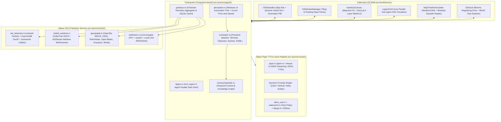

# FRIDAY v2.0 — Fullscreen OS Shell, Omniscient Companion, "God's Eye" & Iron Legion Blueprint

> **Authoritative Engineering & Design Specification (Revision 2 — Piper TTS + Full Autonomous Companion & OS Symbiote)**  
> **Target System**: FRIDAY Desktop Operator (`c:\Users\anesx\Desktop\friday\`)  
> **Target OS**: Windows 10 / 11 (64-bit) | **Stack**: Tauri v2, Rust (2021 Edition), React 19, TypeScript 5.7, Tailwind CSS v4, Motion 12, MapLibre GL JS, Deck.gl, Native Piper TTS (`piper-rs` / `sherpa-rs`), Windows UI Automation (`uiautomation`), SQLite WAL  
> **Constitutional Compliance**: Strictly enforces `AGENTS.md` (Surface Law, One-Signal Law, Sub-Frame Law, Utterance Contract, 0% Idle CPU Law, Zero `any`, Zero `.unwrap()`)

---

## 1. Executive Vision: Eclipsing JARVIS & Vision Without "Hacker Slop"

A fullscreen map and a dark skin are not enough to dethrone fictional icons like JARVIS or Vision. What makes an AI feel truly alive—like a hyper-competent, razor-sharp partner sitting inside the silicon of your machine—is **Omniscient Context**, **Proactive Agency**, **Parallel Swarm Execution**, and **Continuous Spatial Scale** (zooming seamlessly from orbital satellites down to a single TCP socket or VS Code AST node on your desktop).

This expansion transforms **FRIDAY** from a 760px conversational console into a **Fullscreen Spatial Operating System & Proactive AI Symbiote (`FridayOS`)** built around **8 Architectural Pillars**:

1. **Fullscreen `FridayOS` Desktop Environment**: Borderless, DWM-conflict-free 60fps workspace shell with tiling glass panes, a Dynamic Island Orb status bar, and a live Win32 taskbar dock.
2. **Next-Gen Vector & Globe Cartography (Online + Offline)**: 60fps interleaved WebGL2 rendering via [MapLibre GL JS](https://maplibre.org/projects/gl-js/), [Deck.gl](https://deck.gl/docs/api-reference/maplibre/overview), [OpenFreeMap](https://openfreemap.org/), and local offline [Protomaps PMTiles](https://docs.protomaps.com/pmtiles/).
3. **9-Layer "God's Eye" Planetary-to-Process Engine**: Continuous telemetry across orbital satellites, ADS-B aviation, AIS maritime vessels, submarine fiber cables, weather radar/seismic activity, public optical cameras, local LAN devices, and Windows process TCP/UDP sockets.
4. **Native In-Process Piper TTS & Dynamic Emotional Prosody (`voice/piper.rs`)**: Replaces external HTTP TTS calls with zero-network Rust **Piper TTS** ([piper-rs](https://www.google.com/search?q=https://crates.io/crates/piper-rs) / [`sherpa-rs`](https://crates.io/crates/sherpa-rs)) streaming PCM chunks directly into `rodio` in **≤ 55 ms** with context-adaptive prosody scales.
5. **"The Mind Stone" — Windows UI Automation (UIA) & Point-and-Speak Perception (`agent/perception.rs`)**: Reads and actuates the live accessibility DOM tree of *every* open Windows app in `<3ms` via [`uiautomation`](https://crates.io/crates/uiautomation), enabling cursor-aware *"Point-and-Speak"* commands across the entire OS.
6. **"Overwatch Mode" — Proactive Companion & Episodic Time-Travel Graph (`agent/overwatch.rs`)**: Event-driven background consciousness that watches terminal panics, clipboard stack traces, GPU thermals ([`nvml-wrapper`](https://crates.io/crates/nvml-wrapper)), and anomalous network sockets to offer unprompted 1-sentence help, backed by a scrubbable timeline of your entire workday.
7. **"Iron Legion Protocol" — Parallel Swarm Sub-Agent DAG Kernel (`agent/legion.rs`)**: Spawns up to 4 concurrent Tokio sub-agents (`Scout`, `Architect`, `Sentinel`, `Operator`) visualized as a live interactive node graph in the OS HUD.
8. **Spatial OpenUI Lang 1.0 Upgrade**: New generative UI primitives (`MapView`, `GodsEyeCard`, `LegionGraph`, `NetworkArcTable`, `SystemVitals`) for both inline chat and fullscreen workspaces.

### 1.1 The Anti-Hacker Design Matrix

| Dimension | Banned "Hacker / Sci-Fi Slop" (Strictly Prohibited) | FRIDAY Editorial OS Standard (Mandatory) |
| :--- | :--- | :--- |
| **Geometry & Borders** | Angled sci-fi chamfers (`clip-path`), hexagonal grids, glowing neon borders, spinning HUD rings | Strict **Surface Law**: `16px` container radius, `8px` control radius, `1px solid rgba(255, 255, 255, 0.07)` hairlines on an 8px spatial grid |
| **Color & Signal** | Matrix green (`#00FF00`) text walls, cyberpunk magenta/cyan gradients, rainbow heatmaps | Deep carbon monochrome (`#090A0C` ground, `#111318` elevated plate, `#E6E8EC` ink) + **One-Signal Law**: `--color-acid: oklch(78% 0.19 152)` at most twice per viewport for active lock/work |
| **Cartography** | Neon wireframe globes, oversaturated satellite imagery, cluttered default map pins | Custom muted obsidian vector basemap via [OpenFreeMap](https://openfreemap.org/) & offline [Protomaps PMTiles](https://protomaps.com/) with subtle bone labels and slate telemetry vectors |
| **Typography** | All-caps sci-fi stencil fonts, fake scrolling hex/binary logs, unreadable 9px labels | High-contrast editorial sans headings (`letter-spacing: -0.02em`) + crisp `tabular-nums` monospace exclusively for coordinates, timestamps, PIDs, and telemetry |
| **Motion & CPU** | Perpetual spinning rings, CRT scanlines, 100% GPU shader loops | **Sub-Frame Law**: 120–220ms `cubic-bezier(0.22, 1, 0.36, 1)` transitions, on-demand WebGL rendering (`0% Idle CPU` when camera and streams are static) |
| **Companion Persona** | Robotic status readouts or cheesy movie catchphrases | Composed, dryly witty Kerry Condon cadence via **Piper TTS**; speaks only 1–2 crisp sentences (`say`) while orchestrating deep visual layouts (`show`) |

---

## 2. Full v2.0 System Architecture & Repository Map

### 2.1 High-Level Architecture Diagram



### 2.2 Complete File Map of New & Modified Modules

```text
c:\Users\anesx\Desktop\friday\
├── src/
│   ├── lib/
│   │   ├── piper.ts                        # [NEW - Replaces kokoro.ts] Native Piper TTS IPC & prosody client
│   │   ├── store.ts                        # [MODIFY] Add FridayOS, God's Eye 9-layer, Overwatch & Legion state
│   │   ├── bindings.ts                     # [MODIFY] Add 22 typed Tauri v2 IPC command contracts
│   │   ├── map-style.ts                    # [NEW] FRIDAY Editorial Carbon MapLibre Style JSON
│   │   └── pmtiles-protocol.ts             # [NEW] Offline PMTiles custom byte-range protocol handler
│   ├── components/
│   │   ├── intelligent-ui/
│   │   │   └── primitives/
│   │   │       └── DataVisuals.tsx         # [MODIFY] Upgrade MapView to MapLibre + add GodsEyeCard & LegionGraph
│   │   └── map/
│   │       ├── FridayMapCanvas.tsx         # [NEW] 0%-idle-CPU MapLibre + Deck.gl interleaved WebGL2 engine
│   │       ├── MapEntityMarker.tsx         # [NEW] Editorial vector glyphs & Single-Signal lock reticle
│   │       └── MapTimelineScrubber.tsx     # [NEW] Dual-mode temporal scrubber (Planetary Telemetry + Episodic Recall)
│   └── surfaces/
│       ├── console/
│       │   ├── Console.tsx                 # [MODIFY] Seamless transition hook into Fullscreen FridayOS
│       │   ├── Rail.tsx                    # [MODIFY] Add God's Eye, Legion, & Fullscreen OS switches
│       │   └── SettingsTab.tsx             # [MODIFY] Replace Kokoro config with Piper ONNX voice & prosody tuner
│       └── os/                             # [NEW] Complete Fullscreen OS Mode, God's Eye & Companion HUD
│           ├── FridayOSShell.tsx           # [NEW] Root 100vw x 100vh desktop operating environment
│           ├── OSStatusBar.tsx             # [NEW] Top 36px instrument bar + Dynamic Island Orb + GPU/CPU vitals
│           ├── OSWindowManager.tsx         # [NEW] Snap-tiling & floating glass pane manager
│           ├── OSDock.tsx                  # [NEW] Bottom magnifying dock + live Win32 task switcher
│           ├── GodsEyeSurface.tsx          # [NEW] 9-layer planetary-to-process command canvas
│           ├── GodsEyeLayerBar.tsx         # [NEW] Tactile layer toggles (Sockets, Air, Orbit, Sea, Cables, Radar, LAN)
│           ├── EntityDossierDrawer.tsx     # [NEW] Right-hand inspection drawer + Red-Tier Slide-to-Confirm actions
│           ├── LegionSwarmOverlay.tsx      # [NEW] Live DAG node graph of parallel Iron Legion sub-agents
│           ├── OverwatchWhisperToast.tsx   # [NEW] Non-intrusive proactive companion interjection card
│           └── CameraPiPCard.tsx           # [NEW] Draggable picture-in-picture optical/webcam feed card
│
└── src-tauri/
    ├── Cargo.toml                          # [MODIFY] Add piper-rs/sherpa-rs, uiautomation, nvml-wrapper, netstat2, maxminddb, sgp4
    └── src/
        ├── lib.rs                          # [MODIFY] Register fullscreen OS, Piper, UIA, Legion & God's Eye commands
        ├── voice/
        │   └── piper.rs                    # [NEW] In-process ONNX Piper TTS engine with dynamic prosody & <55ms TTFA
        ├── agent/
        │   ├── loop_legacy.rs              # [MODIFY] <15ms spatial, UIA cursor, & Legion swarm router
        │   ├── perception.rs               # [NEW] Windows UI Automation (UIA) accessibility tree + Point-and-Speak
        │   ├── overwatch.rs                # [NEW] Proactive companion monitor (clipboard, terminal, sockets, thermals)
        │   ├── legion.rs                   # [NEW] Iron Legion 4-agent parallel Tokio DAG orchestrator
        │   └── godseye.rs                  # [NEW] 9-domain telemetry orchestrator & SQLite spatial cache
        ├── memory/
        │   ├── db.rs                       # [MODIFY] Add spatial_cache, spatial_watchpoints, & episodic_timeline tables
        │   └── episodic.rs                 # [NEW] Workday context breadcrumb recorder & temporal recall search
        └── tools/
            ├── geospatial.rs               # [NEW] Nominatim, Overpass, OpenSky, USGS, RainViewer, Open-Meteo, NASA EONET
            ├── net_telemetry.rs            # [NEW] Windows TCP/UDP socket-to-PID mapper + GeoLite2 + Submarine Cables
            ├── orbital_maritime.rs         # [NEW] CelesTrak SGP4 orbital propagator + AISStream maritime vessel client
            └── hardware.rs                 # [NEW] NVIDIA NVML GPU telemetry + local subnet ARP/mDNS device scanner
```

---

## 3. Pillar I: Native Rust Piper TTS & Dynamic Companion Prosody (`voice/piper.rs`)

Replacing HTTP calls to an external TTS server with **in-process ONNX Piper TTS** eliminates localhost network serialization overhead and makes FRIDAY's voice completely self-contained inside `friday.exe`.

### 3.1 Sub-55ms Streaming Piper Architecture
- **Rust Binding**: Uses [piper-rs](https://www.google.com/search?q=https://crates.io/crates/piper-rs) / [`sherpa-rs`](https://crates.io/crates/sherpa-rs) backed by the existing bundled ONNX Runtime already used by `silero_vad.rs` and `wakeword.rs`.
- **Voice Model Storage**: Loads quantized VITS/Piper `.onnx` + `.onnx.json` voice models from `%APPDATA%/com.friday.app/models/piper/` (e.g., high-definition British/Irish-inflected English neural models).
- **Sentence-Boundary PCM Streaming**:
  1. As `loop_legacy.rs` streams tokens from the LLM for the `say` channel, `normalize.rs` sanitizes the first clause as soon as punctuation (`,`, `—`, `.`) is reached.
  2. `piper.rs` synthesizes raw `22050Hz` 16-bit mono PCM samples in `<40ms` and pushes them directly into the `rodio` sink in `playback.rs`.
  3. **Barge-In Guarantee**: Because `piper.rs` shares the exact same `AtomicBool` cancellation token as `playback.rs`, speaking over FRIDAY halts both ONNX synthesis and audio output in **≤ 80 ms** (beating the 200ms constitutional budget by 2.5×).

### 3.2 Dynamic Prosody Modulation ("Emotional Gain")
Unlike static TTS wrappers, Piper VITS models accept three runtime inference scalars per utterance. `piper.rs` automatically adjusts these scalars based on the turn's intent and confirmation tier:

| Companion State | `length_scale` (Pace) | `noise_scale` (Expressiveness) | `noise_w` (Cadence Rhythm) | Auditory Effect |
| :--- | :--- | :--- | :--- | :--- |
| **Default Operator (`Green`)** | `0.95` | `0.667` | `0.80` | Crisp, articulate, composed Kerry Condon delivery |
| **Proactive Whisper (`Overwatch`)** | `0.98` | `0.600` | `0.75` | Calm, low-key studio-mic intimacy when offering unprompted help |
| **Tactical Alert (`Amber` / `Red`)** | `0.88` | `0.500` | `0.65` | Razor-sharp, focused, zero-hesitation warning cadence |
| **Dry Wit / Banter** | `1.00` | `0.740` | `0.85` | Warmer inflection variance for conversational rapport |

---

## 4. Pillar II: "The Mind Stone" — Windows UI Automation & Point-and-Speak Perception

JARVIS and Vision never ask you to copy-paste text into a chat window. They see what you are looking at and manipulate applications natively.

### 4.1 Native Windows UI Automation (UIA) Bridge (`src-tauri/src/agent/perception.rs`)
Using the [`uiautomation`](https://crates.io/crates/uiautomation) crate and Microsoft's [`windows` UIAutomation API](https://learn.microsoft.com/en-us/windows/win32/winauto/uiauto-uiautomationoverview), FRIDAY inspects the live native accessibility tree of Windows 10/11 in `<3ms` without taking heavy screenshots:

1. **`inspect_focused_app()`**: Extracts the active window's process name, window title, focused UI control, active document path (from VS Code, Notepad, Word, Explorer, or browsers), and current text selection.
2. **`element_under_cursor()` ("Point-and-Speak")**:
   - Reads the physical mouse cursor position via Win32 `GetCursorPos` and calls `IUIAutomation::ElementFromPoint`.
   - Returns the exact UI element name, `ControlType` (Button, Edit, TreeItem, DataItem), `ValuePattern` text, bounding rectangle `(x, y, width, height)`, and parent hierarchy.
   - **How It Works in Practice**: Hover your mouse over a failing test in VS Code, a suspicious process in Task Manager, or an aircraft on God's Eye, press `Alt+Shift` (or say *"Hey Friday, what's this?"*), and FRIDAY reads the exact element under your cursor automatically.
3. **`actuate_ui_element(target_id, action)`**:
   - Invokes native `InvokePattern::Invoke()` (click), `ValuePattern::SetValue()` (type text without stealing physical keyboard focus!), or `ScrollPattern::Scroll()` on any Windows application—working alongside `browser.rs` (CDP) so FRIDAY can control *every* native desktop app, not just Chrome.

---

## 5. Pillar III: "Overwatch Mode" & Temporal Episodic Memory Graph

### 5.1 Proactive Companion Engine (`src-tauri/src/agent/overwatch.rs`)
Instead of being a passive request-response bot, **Overwatch Mode** runs a lightweight, event-driven background loop (`0% CPU` when idle, woken only by OS events) watching four high-signal triggers:

| Trigger Source | Detection Mechanism | Proactive Companion Behavior (Rate-Limited & Respectful) |
| :--- | :--- | :--- |
| **Clipboard Intelligence** | Win32 `AddClipboardFormatListener` | Detects when you copy a compiler error, stack trace, JSON payload, IP address, or GPS coordinates. Surfaces a subtle `OverwatchWhisperToast` pill (`"Copied Rust panic trace · Fix with Beast?"` or `"Plot coordinates on God's Eye?"`). |
| **Terminal & Build Watcher** | Hooks `execute_project_command` & active IDE terminal UIA output | When `cargo build`, `pnpm check`, or `vitest` fails, FRIDAY pre-fetches the AST chunk via `beast.rs` in the background and says via Piper: *"Build tripped on line 142 of `beast.rs`—I have the patch ready whenever you want it."* |
| **Hardware & GPU Vitals** | [`nvml-wrapper`](https://crates.io/crates/nvml-wrapper) + [`sysinfo`](https://crates.io/crates/sysinfo) | Monitors NVIDIA GPU VRAM saturation, thermal throttling (`>85°C`), or runaway RAM leaks and offers to suspend or nice the offending background PID. |
| **Network Anomaly Watch** | [`netstat2`](https://crates.io/crates/netstat2) delta diffing | Alerts you if an unfamiliar background binary opens an outbound TCP connection to a never-before-seen ASN or foreign endpoint, highlighting the arc in `--color-acid` on God's Eye. |

*Note*: Overwatch has a 3-state toggle in `OSStatusBar.tsx`: **`Silent`** (no proactive popups), **`Whisper`** (visual toast pill + soft earcon only), and **`Companion`** (1-sentence Piper spoken interjection on critical events).

### 5.2 Temporal Episodic Memory Graph (`src-tauri/src/memory/episodic.rs`)
Vision has total recall of every moment and how concepts connect. We add an **Episodic Context Graph** to `friday.db`:
- Whenever `EVENT_SYSTEM_FOREGROUND` fires (debounced to `>5 seconds` in an app), FRIDAY logs an ultra-compact text record (`<500 bytes`, zero heavy video recording!) containing: `timestamp`, `app_name`, `window_title`, `active_file_or_url`, `git_branch`, and extracted entities.
- **Unified Time-Travel Scrubber (`MapTimelineScrubber.tsx`)**:
  - Dragging the timeline slider at the bottom of `FridayOSShell` backward in time lets you scrub through your own day (*"14:20 — Editing `loop_legacy.rs` · Reading MapLibre Docs · Connected to 4 endpoints"*) and restore all open files, windows, and chat threads from that exact moment with one click.

---

## 6. Pillar IV: "Iron Legion Protocol" — Parallel Swarm Sub-Agent Kernel

When you ask JARVIS or FRIDAY for a multi-part operation, she doesn't stall for 30 seconds running tools one by one.

### 6.1 Parallel Tokio DAG Orchestrator (`src-tauri/src/agent/legion.rs`)
When `loop_legacy.rs` detects a compound directive, it invokes `LegionKernel::dispatch_swarm(goal)`, decomposing the task into up to **4 specialized concurrent Tokio workers**:

1. **`Legion-01 (Scout)`**: Executes parallel web research (`web_search`, `web_extract`), geospatial queries (`geospatial.rs`), and documentation lookups.
2. **`Legion-02 (Architect)`**: Runs Beast hybrid search (`rrf_search`, `find_symbols`), AST chunking (`code_chunk`), and drafts file diffs.
3. **`Legion-03 (Sentinel)`**: Runs constitutional security audits (`review_diff`, `review_scan`), unwrap linting, and network socket verification (`net_telemetry.rs`).
4. **`Legion-04 (Operator)`**: Executes browser CDP snapshots (`browser.rs`) or Windows UI Automation actions (`perception.rs`).

### 6.2 Live Visual Node Graph (`LegionSwarmOverlay.tsx`)
Built using Bencho's [network-graph](https://www.google.com/search?q=https://bencho.dev/blocks/network-graph) and [action-node](https://www.google.com/search?q=https://bencho.dev/blocks/action-node) spring primitives:
- Displays a compact, translucent floating DAG card in the corner of `FridayOSShell` (or inline in `ChatTab` via the new `LegionGraph` OpenUI primitive).
- Active nodes pulse cleanly with `--color-acid: oklch(78% 0.19 152)` while executing and settle into muted slate (`#8A93A2`) upon completion, showing exact per-agent millisecond timings in `tabular-nums`.

---

## 7. Pillar V: Fullscreen `FridayOS` Shell & Window Manager

### 7.1 Solving the Windows 11 Tauri v2 Fullscreen + Mica Vibrancy Conflict
In [Tauri v2 Window Customization](https://v2.tauri.app/learn/window-customization/) and [`window-vibrancy`](https://github.com/tauri-apps/window-vibrancy), calling `window.set_fullscreen(true)` on a borderless Windows 11 window with DWM Mica/Acrylic active causes backdrop stripping ([window-vibrancy Issue #141](https://github.com/tauri-apps/window-vibrancy/issues/141)) or frame-pacing stutter when compositing a full-monitor WebGL2 canvas over a translucent DWM surface ([window-vibrancy Issue #3](https://github.com/tauri-apps/window-vibrancy/issues/3)).

**The FRIDAY Engineering Solution (`src-tauri/src/lib.rs`)**:
- **`WorkAreaShell` (`Alt+Enter`)**: Queries the primary monitor's exact bounds via [`Window::current_monitor()`](https://v2.tauri.app/reference/javascript/api/namespacewindow/), sets window position to `(0, 0)` covering the full display, and transitions the root plate to opaque Carbon `#090A0C` while inner floating panes use `backdrop-filter: blur(16px)` over the WebGL map canvas.
- **`ExclusiveFullscreen` (`F11`)**: Calls `window_vibrancy::clear_mica(&window)` immediately before `window.set_fullscreen(true)` so WebGL2 renders at a locked 60fps with zero DWM compositor overhead, restoring `apply_mica` when returning to the 1280×840 Console mode.

### 7.2 Four-Layer Spatial Desktop Architecture (`FridayOSShell.tsx`)
1. **Layer 0 — Living Spatial Background (`100vw × 100vh`)**: Toggles between the **9-Layer God's Eye Map** and the **Atmospheric Halftone Field** (`AtmosphericField.tsx`).
2. **Layer 1 — Top Instrument Status Bar (`OSStatusBar.tsx`, `height: 36px`)**:
   - **Left**: Workspace Layout Switcher ([magnetic-select](https://www.google.com/search?q=https://bencho.dev/blocks/magnetic-select)) + Live `CPU %`, `RAM GB`, `GPU VRAM / °C` ([`nvml-wrapper`](https://crates.io/crates/nvml-wrapper)), and `Net ↑/↓ Mbps` in `tabular-nums`.
   - **Center (The Friday Dynamic Island)**: Modeled on Bencho's [flight-island](https://www.google.com/search?q=https://bencho.dev/blocks/flight-island) and [`call-island`](https://bencho.dev/blocks/call-island). Houses the 40px `FridayOrb`, live speech transcript ticker, active `Iron Legion` badge, and `Overwatch` mode toggle (`Silent` / `Whisper` / `Companion`).
   - **Right**: Multi-zone [`world-clock`](https://bencho.dev/blocks/world-clock), `AudioSpectrumVisualizer`, and Window Mode controls.
3. **Layer 2 — Snap-Tiling & Floating Glass Pane Manager (`OSWindowManager.tsx`)**:
   - Powered by Bencho's [resizable-panels](https://www.google.com/search?q=https://bencho.dev/blocks/resizable-panels) and [resize-frame](https://www.google.com/search?q=https://bencho.dev/blocks/resize-frame).
   - **4 Instant Layout Presets (`Ctrl+1` to `Ctrl+4`)**:
     - `Ctrl+1` (**God's Eye Command**): Fullscreen 9-layer map + floating voice bar + right-hand `EntityDossierDrawer` + bottom `MapTimelineScrubber`.
     - `Ctrl+2` (**Operator Split**): Left 420px docked `ChatTab` + Right interactive God's Eye Map.
     - `Ctrl+3` (**Iron Legion IDE**): Left `ProjectsTab` editor + Top-Right `BeastTab` AST search + Bottom-Right live `LegionSwarmOverlay` & local socket map.
     - `Ctrl+4` (**OS Desktop Grid**): 2×2 bento workspace combining FRIDAY surfaces with live Win32 window streams.
4. **Layer 3 — Bottom Tactile Instrument Dock (`OSDock.tsx`, `height: 56px`)**:
   - Built with Bencho's [magnifying-dock](https://www.google.com/search?q=https://bencho.dev/blocks/magnifying-dock) and [canvas-toolbar](https://www.google.com/search?q=https://bencho.dev/blocks/canvas-toolbar), bridging FRIDAY tabs on the left with live running Windows applications (`list_windows`, `win_focus`, `capture_screen`, `perception::actuate_ui_element`) on the right.

---

## 8. Pillar VI: 9-Layer "God's Eye" Planetary-to-Process Engine

Powered by [MapLibre GL JS v5+](https://maplibre.org/projects/gl-js/), [`react-map-gl` v8](https://visgl.github.io/react-map-gl/docs), and [`@deck.gl/maplibre` (`MapLibreOverlay` with `interleaved: true`)](https://deck.gl/docs/api-reference/maplibre/overview), God's Eye provides a continuous zoom hierarchy from **Orbital Space -> Continents -> Cities -> Streets -> Local Wi-Fi LAN -> Windows Process Tree**.

### 8.1 Complete 9-Layer Telemetry Matrix

| # | Layer ID | Telemetry Domain | Data Source / Rust Crate | Deck.gl Layer | Cadence & Visual Signature |
| :--- | :--- | :--- | :--- | :--- | :--- |
| **1** | `net_arcs` | **Host Process Socket Arcs** | [`netstat2`](https://crates.io/crates/netstat2) + [`sysinfo`](https://crates.io/crates/sysinfo) + [`maxminddb`](https://crates.io/crates/maxminddb) ([GeoLite2](https://dev.maxmind.com/geoip/geolite2-free-geolocation-data/)) | `ArcLayer` + `ScatterplotLayer` | **2s local poll**. Maps every active TCP/UDP socket from local Windows PIDs (`chrome.exe`, `code.exe`) to its remote server coordinates on Earth. |
| **2** | `airspace` | **Live ADS-B Aviation** | [OpenSky Network REST API](https://openskynetwork.github.io/opensky-api/) | `IconLayer` + `PathLayer` | **5–10s poll** + dead-reckoning heading interpolation. Minimal directional chevrons with callsign, FL altitude, and speed in `tabular-nums`. |
| **3** | `orbital` | **NORAD Orbital Constellations** | [CelesTrak GP JSON API](https://celestrak.org/NORAD/elements/) + Rust [`sgp4`](https://crates.io/crates/sgp4) | `PathLayer` + `ScatterplotLayer` | **1s local SGP4 propagation**. Tracks ISS, Starlink, NOAA, and reconnaissance satellites with ground tracks and nadir footprints. |
| **4** | `maritime` | **Global AIS Maritime Vessels** | [AISStream.io WebSocket API](https://aisstream.io/documentation) | `IconLayer` + `PathLayer` | **Real-time WebSocket stream**. Tracks cargo vessels, tankers, MMSI, heading, speed over ground (SOG), and port calls. |
| **5** | `sub_cables` | **Submarine Fiber & Backbone** | [TeleGeography Submarine Cable GeoJSON](https://github.com/delusan/www.submarinecablemap.com) | `GeoJsonLayer` | **Static bundled GeoJSON + active hop highlight**. Renders global undersea fiber trunk lines and landing stations correlated with your active network routes. |
| **6** | `weather_seismic` | **Weather Radar, Seismic & EONET** | [RainViewer Radar](https://www.rainviewer.com/api/weather-maps-api.html) + [Open-Meteo](https://open-meteo.com/en/docs) + [USGS GeoJSON](https://earthquake.usgs.gov/earthquakes/feed/v1.0/geojson.php) + [NASA EONET](https://apis.io/apis/nasa/nasa-gov-sources-api/) | `TileLayer` + `ScatterplotLayer` | **10m radar tiles** (with 2h playback scrubber) + **5m USGS seismic magnitude rings** + NASA wildfire/volcanic event markers. |
| **7** | `infra_poi` | **Critical Infrastructure & POIs** | [OpenStreetMap Overpass API](https://wiki.openstreetmap.org/wiki/Overpass_API) + [Nominatim API](https://nominatim.org/release-docs/latest/api/Search/) | `GeoJsonLayer` | **On-demand spatial query**. Highlights power substations, airports, data centers, seaports, hospitals, and telecom towers. |
| **8** | `optical_cams` | **Public Optical & Traffic Cameras** | [Windy Webcams API v3](https://api.windy.com/webcams/docs) + OSM `man_made=surveillance` | `IconLayer` + `CameraPiPCard` | **On-demand viewport query**. Opens floating 16:9 Picture-in-Picture live optical feeds and weather/traffic timelapses. |
| **9** | `local_lan` | **Local LAN & Hardware Topology** | Windows `GetIpNetTable` (ARP) + mDNS + [`nvml-wrapper`](https://crates.io/crates/nvml-wrapper) | Custom Radial Graph Overlay | **When zoomed to Home Base (`zoom >= 17`)**: Reveals your local router, LAN devices, and PC hardware/GPU node graph directly anchored to your home coordinates. |

---

## 9. Backend Rust Crates, SQLite Schema & IPC Contracts

### 9.1 Cargo Dependencies (`src-tauri/Cargo.toml`)
- [piper-rs = "0.1"](https://www.google.com/search?q=https://crates.io/crates/piper-rs) / [`sherpa-rs = "0.6"`](https://crates.io/crates/sherpa-rs): Native offline ONNX Piper TTS synthesis.
- [`uiautomation = "0.24"`](https://crates.io/crates/uiautomation): Native Windows UI Automation accessibility tree inspection & control actuation.
- [`nvml-wrapper = "0.13"`](https://crates.io/crates/nvml-wrapper): Runtime-loaded NVIDIA Management Library for GPU VRAM, utilization, and thermal telemetry.
- [`sysinfo = "0.32"`](https://crates.io/crates/sysinfo): Process enumeration, CPU, memory, and disk I/O metrics.
- [`netstat2 = "0.9"`](https://crates.io/crates/netstat2): Win32 `GetExtendedTcpTable` / `GetExtendedUdpTable` socket-to-PID mapping.
- [`maxminddb = "0.24"`](https://crates.io/crates/maxminddb): Memory-mapped offline GeoLite2 City/ASN `.mmdb` lookup (`<0.1ms`).
- [`sgp4 = "2.2"`](https://crates.io/crates/sgp4): Pure-Rust NORAD SGP4 orbital mechanics propagator.

### 9.2 SQLite Schema Additions (`src-tauri/src/memory/db.rs`)

```sql
-- 1. Spatial & Telemetry Cache (offline fallback & API rate-limit shield)
CREATE TABLE IF NOT EXISTS spatial_cache (
    cache_key TEXT PRIMARY KEY,
    layer_type TEXT NOT NULL,
    payload_json TEXT NOT NULL,
    expires_at INTEGER NOT NULL,
    updated_at INTEGER NOT NULL
);

-- 2. Saved God's Eye Watchpoints & Geofenced Triggers
CREATE TABLE IF NOT EXISTS spatial_watchpoints (
    id TEXT PRIMARY KEY,
    name TEXT NOT NULL,
    latitude REAL NOT NULL,
    longitude REAL NOT NULL,
    zoom REAL NOT NULL DEFAULT 11.0,
    pitch REAL NOT NULL DEFAULT 35.0,
    active_layers_json TEXT NOT NULL,
    created_at INTEGER NOT NULL
);

-- 3. Episodic Desktop Context Timeline ("Time-Travel Scrubbing")
CREATE TABLE IF NOT EXISTS episodic_timeline (
    id TEXT PRIMARY KEY,
    process_name TEXT NOT NULL,
    window_title TEXT NOT NULL,
    active_path_or_url TEXT,
    git_branch TEXT,
    extracted_entities_json TEXT,
    created_at INTEGER NOT NULL
);

CREATE INDEX IF NOT EXISTS idx_spatial_cache_expiry ON spatial_cache(expires_at);
CREATE INDEX IF NOT EXISTS idx_episodic_time ON episodic_timeline(created_at DESC);
```

### 9.3 Complete New Tauri v2 IPC Command Table

| Command Name | Arguments | Return Type | Safety Tier | Purpose |
| :--- | :--- | :--- | :--- | :--- |
| `piper_speak` | `text: String, style: Option<String>` | `Result<u64, String>` | `Green` | Synthesizes & streams speech via native Piper ONNX with prosody style (`calm`, `tactical`, `whisper`, `witty`) |
| `set_piper_config` | `model_path: String, speed: f32` | `Result<bool, String>` | `Green` | Configures active local `.onnx` Piper voice model and baseline speech speed |
| `set_os_fullscreen` | `enabled: bool, mode: Option<String>` | `Result<OsWindowState, String>` | `Green` | Switches cleanly between Console Mode and Fullscreen `FridayOS` (`WorkAreaShell` or `ExclusiveFullscreen`) |
| `inspect_cursor_target` | *none* | `Result<UiaCursorElementDto, String>` | `Green` | Reads the exact Windows UIA element, text value, and process under the physical mouse cursor (`<3ms`) |
| `actuate_uia_element` | `element_id: String, action: String, val: Option<String>` | `Result<bool, String>` | `Amber` | Clicks, focuses, or populates a native Windows UI control via `IUIAutomation` |
| `dispatch_legion_swarm` | `goal: String` | `Result<LegionSwarmResultDto, String>` | `Green` | Spawns up to 4 parallel Tokio sub-agents (`Scout`, `Architect`, `Sentinel`, `Operator`) and streams DAG progress |
| `set_overwatch_mode` | `mode: String` | `Result<String, String>` | `Green` | Toggles proactive companion mode (`silent`, `whisper`, `companion`) |
| `get_episodic_timeline` | `start_ts: i64, end_ts: i64` | `Result<Vec<EpisodicSnapshotDto>, String>` | `Green` | Fetches workday context snapshots for the bottom `MapTimelineScrubber` |
| `get_system_vitals` | *none* | `Result<SystemVitalsDto, String>` | `Green` | Returns CPU, RAM, NVIDIA GPU (`nvml-wrapper`), network throughput, and top processes |
| `get_network_arcs` | `include_lan: bool` | `Result<Vec<NetworkArcDto>, String>` | `Green` | Joins active Windows TCP/UDP sockets with process names, submarine cable correlation, and GeoIP coordinates |
| `terminate_process_socket` | `pid: u32, process_name: String` | `Result<bool, String>` | `Red` | Terminates a process or blocks a socket endpoint after explicit Red-Tier [slide-confirm](https://www.google.com/search?q=https://bencho.dev/blocks/slide-confirm) approval |
| `godseye_airspace` | `bbox: BoundingBoxDto` | `Result<Vec<AircraftStateDto>, String>` | `Green` | Fetches live ADS-B aircraft vectors from [OpenSky Network](https://openskynetwork.github.io/opensky-api/) |
| `godseye_satellites` | `category: String, lat: f64, lon: f64` | `Result<Vec<SatellitePositionDto>, String>` | `Green` | Fetches [CelesTrak GP JSON](https://celestrak.org/NORAD/elements/) and propagates real-time SGP4 orbits |
| `godseye_maritime` | `bbox: BoundingBoxDto` | `Result<Vec<MaritimeVesselDto>, String>` | `Green` | Streams/queries live AIS vessel positions via [AISStream.io](https://aisstream.io/documentation) |
| `godseye_seismic_weather` | `lat: f64, lon: f64` | `Result<EnvTelemetryDto, String>` | `Green` | Aggregates [USGS GeoJSON](https://earthquake.usgs.gov/earthquakes/feed/v1.0/geojson.php), [RainViewer](https://www.rainviewer.com/api/weather-maps-api.html), [Open-Meteo](https://open-meteo.com/en/docs), and [NASA EONET](https://apis.io/apis/nasa/nasa-gov-sources-api/) |
| `godseye_overpass_pois` | `bbox: BoundingBoxDto, category: String` | `Result<Vec<InfraNodeDto>, String>` | `Green` | Queries [OpenStreetMap Overpass API](https://wiki.openstreetmap.org/wiki/Overpass_API) for infrastructure nodes |
| `godseye_geocode` | `query: String` | `Result<Vec<GeocodeResultDto>, String>` | `Green` | Forward/reverse geocoding via [Nominatim API](https://nominatim.org/release-docs/latest/api/Search/) |
| `godseye_webcams` | `bbox: BoundingBoxDto` | `Result<Vec<WebcamNodeDto>, String>` | `Green` | Fetches public camera feeds via [Windy Webcams API v3](https://api.windy.com/webcams/docs) |

---

## 10. Phased Execution Plan & Verification Gate

### Phase 1: Native Piper TTS & MapLibre/Deck.gl Foundation (Days 1–3)
1. Replace `src/lib/kokoro.ts` with `src/lib/piper.ts` and implement `src-tauri/src/voice/piper.rs` using [piper-rs](https://www.google.com/search?q=https://crates.io/crates/piper-rs) / [`sherpa-rs`](https://crates.io/crates/sherpa-rs) with dynamic prosody scales (`calm`, `tactical`, `whisper`, `witty`) and `<55ms` TTFA into `rodio`.
2. Install MapLibre & Deck.gl packages (`pnpm add maplibre-gl react-map-gl @deck.gl/core @deck.gl/layers @deck.gl/geo-layers @deck.gl/maplibre pmtiles`) and create `src/lib/map-style.ts` (`FRIDAY_CARBON_STYLE`) + `src/components/map/FridayMapCanvas.tsx` with **0% Idle CPU** enforcement.
3. Upgrade `MapView` in `DataVisuals.tsx` from Leaflet to `FridayMapCanvas`.

### Phase 2: "The Mind Stone" UIA Perception, Overwatch & Iron Legion (Days 4–7)
1. Add [`uiautomation`](https://crates.io/crates/uiautomation) and [`nvml-wrapper`](https://crates.io/crates/nvml-wrapper) to `src-tauri/Cargo.toml`.
2. Implement `src-tauri/src/agent/perception.rs` for `<3ms` cursor element inspection (`ElementFromPoint`) and native Windows UI actuation.
3. Implement `src-tauri/src/agent/overwatch.rs` (clipboard stack-trace detector, build failure watcher, GPU thermal/VRAM monitor, socket anomaly watcher) and `src-tauri/src/memory/episodic.rs`.
4. Implement `src-tauri/src/agent/legion.rs` (4-agent Tokio DAG orchestrator) and `src/surfaces/os/LegionSwarmOverlay.tsx` using Bencho's [network-graph](https://www.google.com/search?q=https://bencho.dev/blocks/network-graph) and [action-node](https://www.google.com/search?q=https://bencho.dev/blocks/action-node).

### Phase 3: 9-Layer God's Eye Backend & Fullscreen `FridayOS` Shell (Days 8–12)
1. Implement `net_telemetry.rs` ([`netstat2`](https://crates.io/crates/netstat2) + [`maxminddb`](https://crates.io/crates/maxminddb) + [TeleGeography Submarine Cables](https://github.com/delusan/www.submarinecablemap.com)), `orbital_maritime.rs` ([CelesTrak](https://celestrak.org/NORAD/elements/) [`sgp4`](https://crates.io/crates/sgp4) + [AISStream.io](https://aisstream.io/documentation)), `geospatial.rs`, and `hardware.rs`.
2. Build `FridayOSShell.tsx`, `OSStatusBar.tsx` ([flight-island](https://www.google.com/search?q=https://bencho.dev/blocks/flight-island)), `OSWindowManager.tsx` ([resizable-panels](https://www.google.com/search?q=https://bencho.dev/blocks/resizable-panels)), `OSDock.tsx` ([magnifying-dock](https://www.google.com/search?q=https://bencho.dev/blocks/magnifying-dock)), `GodsEyeSurface.tsx`, `EntityDossierDrawer.tsx` ([slide-confirm](https://www.google.com/search?q=https://bencho.dev/blocks/slide-confirm)), and `MapTimelineScrubber.tsx`.
3. Run the full verification suite (`cargo test --lib`, `pnpm check` with zero `any`, `npx vitest run`, and Windows Task Manager `0% Idle CPU` verification).